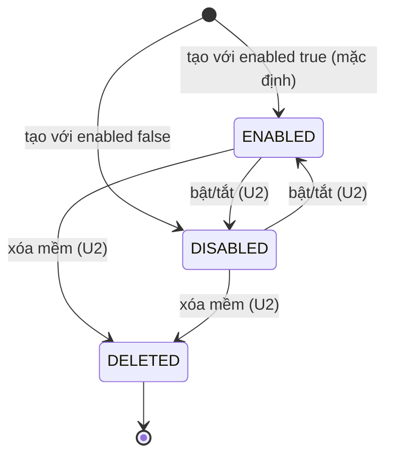
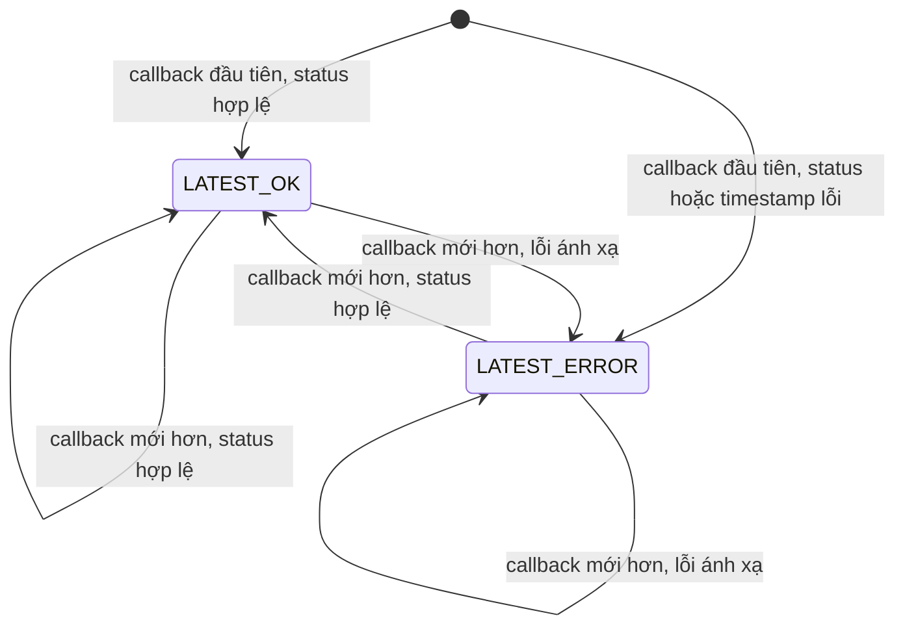
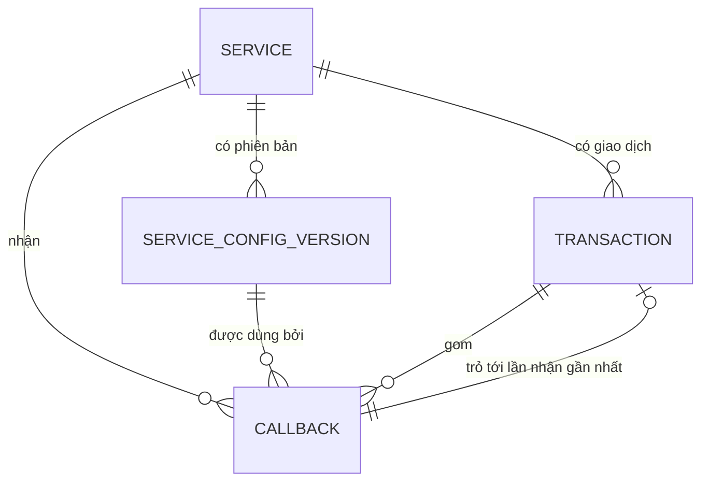

# Đặc tả chức năng — U1 `u1-backend-skeleton`

> Nguồn: `unit-of-work`, `unit-of-work-story-map`, `requirements`, `components` và `contract-summary` (đã cập nhật theo Q1 A), cùng `functional-design-questions.md` (Q1 đến Q5 chọn A, 19 giả định chấp nhận). Tài liệu này là nguồn sự thật cho **quy trình từng bước và máy trạng thái**; dữ liệu nằm ở `entities.md`, quy tắc quyết định nằm ở `rules.md`. Hai mục "Sơ đồ quan hệ" và "Tóm tắt quy tắc" dưới đây chỉ là cách nhìn dẫn xuất.
>
> Không có mã, SQL hay tên framework ở đây. Các câu lệnh cURL minh họa ở mục cuối chỉ để người đọc kiểm chứng được tiêu chí.

## 1. Phạm vi của U1

U1 là lát cắt skeleton: tạo dịch vụ, nhận callback đường vui, ánh xạ, lưu và tra cứu qua API. Bảng dưới ghi rõ cái gì U1 làm, cái gì U1 chỉ chặn an toàn, cái gì để U2.

| Hạng mục | U1 | U2 |
|---|---|---|
| Tạo dịch vụ (`POST /api/services`) | Có, kiểm tra tối giản (BR1.1 đến BR1.8) | Hoàn thiện kiểm tra cú pháp đường dẫn, mẫu thời gian, khóa API |
| Đọc một dịch vụ (`GET /api/services/{serviceCode}`) | Có (BR1.9) | Thêm danh sách, sửa, bật/tắt, xóa mềm, phiên bản khi sửa |
| Xác thực `NONE` | Có | — |
| Xác thực `API_KEY` | Từ chối lúc tạo (BR1.6) | Làm đầy đủ |
| Định dạng thời gian | ISO 8601 (BR3.6) | Unix giây, mili giây, mẫu chuỗi, múi giờ |
| Phân trang cơ bản của danh sách giao dịch (`page`, `size`, `Page`) | Có (BR5.1), AC1.14.2 một phần | Bộ lọc, danh sách callback, hiệu năng |
| Nhận callback đường vui | Có (nhóm BR2, BR3, BR4) | — |
| Mã từ chối 413, 404, 503, 400 | Trả mã, chưa ghi lần nhận bị từ chối (BR2.2 đến BR2.4) | Ghi lần nhận bị từ chối, thêm 401 |
| Gom giao dịch | Có, ghi nguyên tử (BR4.1 đến BR4.5) | Kiểm chứng đồng thời 50 callback (BR4.6) |
| API đọc | Danh sách giao dịch không lọc và chi tiết giao dịch (BR5.1 đến BR5.3) | Bộ lọc, danh sách callback, chi tiết một lần nhận |

## 2. Quy trình

### W1 — Tạo dịch vụ

Tác nhân: lập trình viên gọi bằng cURL (giao diện dùng lại ở U3).

1. Nhận `POST /api/services` với thân JSON theo `ServiceCreate`.
2. Kiểm tra từng trường theo BR1.1, BR1.3, BR1.4, BR1.5, BR1.6, BR1.7. Thu thập **mọi** lỗi trường cùng lúc; nếu có lỗi, trả 400 `VALIDATION_FAILED` kèm `fieldErrors` và dừng.
3. Mở một giao dịch cơ sở dữ liệu.
4. Ghi Service (mã đúng chữ gốc, `enabled` theo yêu cầu hoặc mặc định true, `deleted` false, `currentVersionNumber` 1). Nếu khóa duy nhất không phân biệt hoa thường bị vi phạm: hủy giao dịch, trả 409 `SERVICE_CODE_DUPLICATE` (BR1.2).
5. Ghi ServiceConfigVersion số 1 từ phần cấu hình xử lý của yêu cầu (BR1.8).
6. Hoàn tất giao dịch. Lỗi bất kỳ ở bước 4 đến 6 ngoài trùng mã: hủy, trả 500 `INTERNAL_ERROR`.
7. Trả 201 với `Service`: có `callbackPath`, `apiKeyConfigured` là false, **không có** `apiKeySecret`.

### W2 — Nhận callback

Tác nhân: hệ thống ngân hàng (hoặc cURL). Mọi nhánh lỗi dưới đây sinh response có header `X-Simulator-Error` (BR2.5).

1. Nhận `POST /callbacks/{serviceCode}`. Ghi nhận `receivedAt` bằng đồng hồ server ngay lúc bắt đầu (BR2.6).
2. Nếu body vượt 1.048.576 byte: trả 413 `PAYLOAD_TOO_LARGE`, dừng, không ghi gì (BR2.2).
3. Khớp dịch vụ không phân biệt hoa thường (BR2.1). Không có: trả 404 `SERVICE_NOT_FOUND`, dừng, không ghi gì.
4. Nếu dịch vụ đã xóa: 404 `SERVICE_NOT_FOUND`. Nếu dịch vụ tắt: 503 `SERVICE_DISABLED`. Dừng, chưa ghi (BR2.3).
5. Kiểm tra loại phương tiện của Content-Type là `application/json` (bỏ qua tham số, không phân biệt hoa thường): nếu khác, 400 `UNSUPPORTED_CONTENT_TYPE`, dừng (BR2.4).
6. Phân tích body thành JSON. Rỗng hoặc không hợp lệ: 400 `INVALID_JSON`, dừng (BR2.4).
7. Đọc phiên bản cấu hình hiện hành của dịch vụ (BR2.7).
8. Chạy ánh xạ (W3) trên giá trị JSON gốc với cấu hình phiên bản đó, được ba `FieldResult` và `outcome` (BR3.8).
9. Che header (BR2.10) và dựng Callback: payload gốc, header đã che, `receivedAt`, `configVersionId`, `outcome`, kết quả ba trường, mã HTTP và body sẽ trả.
10. Mở một giao dịch cơ sở dữ liệu. Ghi Callback (nhận `recordId`). Nếu `transactionId` hợp lệ: tạo hoặc cập nhật Transaction (W4). Hoàn tất giao dịch (BR2.11). Lỗi bất kỳ: hủy, trả 500 `INTERNAL_ERROR` (BR2.8).
11. Trả response đã cấu hình của phiên bản đã dùng: đúng `responseHttpStatus`, đúng `responseBody`, `Content-Type: application/json`, không có header `X-Simulator-Error` (BR2.8).
12. Ghi một dòng nhật ký không chứa dữ liệu nhạy cảm (BR2.12).

Bảng kết quả của W2:

| Điều kiện | HTTP | Mã lỗi (`X-Simulator-Error` và trường `error`) | Có ghi Callback? |
|---|---|---|---|
| Body quá 1.048.576 byte | 413 | `PAYLOAD_TOO_LARGE` | Không |
| Mã dịch vụ chưa từng có | 404 | `SERVICE_NOT_FOUND` | Không |
| Dịch vụ đã xóa | 404 | `SERVICE_NOT_FOUND` | Không (U2 sẽ ghi) |
| Dịch vụ tắt | 503 | `SERVICE_DISABLED` | Không (U2 sẽ ghi) |
| Content-Type không phải JSON | 400 | `UNSUPPORTED_CONTENT_TYPE` | Không (U2 sẽ ghi) |
| Body rỗng hoặc JSON hỏng | 400 | `INVALID_JSON` | Không (U2 sẽ ghi) |
| Chấp nhận, ánh xạ tốt hoặc lỗi | Theo cấu hình | Không có | Có (`SUCCESS` hoặc `MAPPING_ERROR`) |
| Lỗi ghi cơ sở dữ liệu | 500 | `INTERNAL_ERROR` | Không (hủy cả hai) |

### W3 — Ánh xạ một payload

Đầu vào: giá trị JSON gốc và phiên bản cấu hình. Đầu ra: ba `FieldResult` và `outcome`. Không có tác dụng phụ.

1. Nếu giá trị gốc không phải object: transactionId, status và timestamp (nếu có đường dẫn) đều có lỗi `PAYLOAD_NOT_OBJECT`; sang bước 5 (BR3.4).
2. Với transactionId rồi status, độc lập nhau: đi theo đường dẫn (BR3.1). Không tìm thấy: `NOT_FOUND`. Tìm thấy: kiểm tra null, rỗng, chỉ khoảng trắng: `EMPTY`; object hoặc mảng: `WRONG_TYPE`; chuỗi, số, boolean: lấy thành chuỗi nguyên văn (BR3.2) rồi kiểm tra dài quá 255 ký tự: `TOO_LONG` (BR3.3).
3. Với timestamp: nếu không có `timestampPath`, bỏ qua. Nếu không tìm thấy, null hoặc rỗng: không có giá trị, có cảnh báo (BR3.5). Nếu có giá trị: object hoặc mảng là `WRONG_TYPE`; ngược lại phân tích ISO 8601, thiếu múi giờ thì dùng `defaultTimeZone`, đổi về UTC; không đọc được là `UNPARSEABLE` (BR3.6).
4. Không diễn giải status (BR3.7).
5. `outcome` là `SUCCESS` nếu cả ba trường không lỗi (cảnh báo không tính), ngược lại `MAPPING_ERROR` (BR3.8).

### W4 — Cập nhật giao dịch trong lúc ghi Callback

Chạy bên trong giao dịch cơ sở dữ liệu của W2 bước 10, chỉ khi `transactionId` hợp lệ (BR4.2).

1. Tìm Transaction theo (serviceCode, transactionId) đúng chữ gốc của dịch vụ (BR4.1).
2. Nếu chưa có: tạo với `callbackCount` bằng 1 và các trường `latest*` lấy từ Callback vừa ghi (BR4.3).
3. Nếu đã có: tăng `callbackCount` thêm 1. So cặp (`receivedAt`, `recordId`) của Callback vừa ghi với cặp đang lưu: nếu lớn hơn thì thay các trường `latest*` (status có thể trống, cờ lỗi ánh xạ theo `outcome`); nếu không lớn hơn thì giữ nguyên `latest*` (BR4.4, BR4.5).
4. Việc tìm và cập nhật phải đúng khi có hai W4 cùng giao dịch chạy song song; cách bảo đảm do NFR Design chọn (BR4.6).

### W5 — Danh sách giao dịch

1. Nhận `GET /api/transactions` với `page` và `size`.
2. Nếu có tham số lọc (`serviceCode`, `transactionId`, `status`, `receivedFrom`, `receivedTo`): 400 `VALIDATION_FAILED`, `fieldErrors` có tên từng tham số (BR5.2).
3. Nếu `page` nhỏ hơn 1 hoặc `size` không phải 20, 50, 100: 400 `VALIDATION_FAILED` (BR5.1).
4. Đọc trang từ bảng Transaction, sắp theo thời điểm nhận gần nhất mới trước, hòa nhau theo mã bản ghi gần nhất lớn hơn; trả `items`, `page`, `size`, `totalItems`, `totalPages`.

### W6 — Chi tiết giao dịch

1. Nhận `GET /api/transactions/detail?serviceCode=...&transactionId=...`. Thiếu một trong hai: 400 `VALIDATION_FAILED`.
2. Khớp serviceCode không phân biệt hoa thường, transactionId chính xác (BR5.3). Không có giao dịch: 404 `TRANSACTION_NOT_FOUND`.
3. Trả `TransactionSummary` và danh sách `CallbackDetail` theo thứ tự nhận, mỗi phần tử có payload gốc, header đã che, `receivedAt`, kết quả ba trường, response đã trả và `configVersionNumber`.

### W7 — Đọc một dịch vụ

1. Nhận `GET /api/services/{serviceCode}`. Khớp không phân biệt hoa thường (BR1.9).
2. Có: 200 với `Service` (không có `apiKeySecret`). Không có: 404 `SERVICE_NOT_FOUND`.

## 3. Máy trạng thái

### Service (phần U1 làm được)

U1 chỉ có hai trạng thái khởi tạo; mọi chuyển trạng thái là của U2. DELETED là trạng thái cuối: mã không dùng lại được.

### Callback

Callback không có chuyển trạng thái. Nó được ghi một lần với `outcome` cuối cùng (`SUCCESS` hoặc `MAPPING_ERROR` ở U1; `REJECTED` ở U2) và không bao giờ sửa hay xóa (BR2.9).

### Transaction

"Mới hơn" nghĩa là cặp (`receivedAt`, `recordId`) lớn hơn cặp đang lưu; callback cũ hơn đến muộn chỉ làm `callbackCount` tăng 1 và không đổi trạng thái (BR4.4). Giao dịch không bao giờ bị xóa.

## 4. Mã lỗi

Mọi lỗi do ứng dụng sinh ra có `X-Simulator-Error` bằng đúng giá trị trường `error` (BR2.5). Bảng này cũng là danh mục thống nhất theo góp ý R-04.

| Mã (`error`) | HTTP | Nơi dùng ở U1 |
|---|---|---|
| `VALIDATION_FAILED` | 400 | Tạo dịch vụ (BR1.1 đến BR1.7), tham số danh sách và chi tiết giao dịch (BR5.1 đến BR5.3) |
| `UNSUPPORTED_CONTENT_TYPE` | 400 | Endpoint callback (BR2.4) |
| `INVALID_JSON` | 400 | Endpoint callback (BR2.4) |
| `SERVICE_NOT_FOUND` | 404 | Endpoint callback, đọc dịch vụ (BR2.1, BR2.3, BR1.9) |
| `TRANSACTION_NOT_FOUND` | 404 | Chi tiết giao dịch (BR5.3) |
| `SERVICE_CODE_DUPLICATE` | 409 | Tạo dịch vụ (BR1.2) |
| `PAYLOAD_TOO_LARGE` | 413 | Endpoint callback (BR2.2) |
| `INTERNAL_ERROR` | 500 | Mọi nơi khi lỗi ghi hoặc lỗi bất ngờ (BR2.8, BR2.11, BR1.8) |
| `SERVICE_DISABLED` | 503 | Endpoint callback (BR2.3) |
| `UNAUTHORIZED`, `CALLBACK_NOT_FOUND` | 401, 404 | Chỉ khai báo trong hợp đồng; U2 dùng |

Mã lỗi ánh xạ từng trường (nằm trong `FieldResult`, không phải mã HTTP): `NOT_FOUND`, `EMPTY`, `WRONG_TYPE`, `TOO_LONG`, `PAYLOAD_NOT_OBJECT`, `UNPARSEABLE`.

## 5. Sửa đổi hợp đồng theo Q1 A

Bản rà soát hợp đồng (`reviews/review-01.md`) còn 12 góp ý. Theo Q1 A, 11 góp ý được sửa vào `contract-summary.md` trong bước này; R-10 để NFR Design. Cột cuối là chỗ tương ứng trong thiết kế.

| Góp ý | Sửa đổi | Chỗ thiết kế |
|---|---|---|
| R-01 | Chi tiết giao dịch dùng `GET /api/transactions/detail` với tham số truy vấn `serviceCode` và `transactionId` (Q2 A) | W6, BR5.3 |
| R-02 | Header `X-Simulator-Error` trên mọi response lỗi do ứng dụng sinh; bỏ câu phân biệt dựa trên trường `error` (Q3 A) | BR2.5 |
| R-03 | Schema `Service` không có `apiKeySecret`; chỉ `ServiceCreate` và `ServiceUpdate` có | BR1.8 |
| R-04 | Mã 409 là `SERVICE_CODE_DUPLICATE`; một bảng mã lỗi duy nhất; thống nhất `ErrorResponse` và `FieldResult` | Mục 4 |
| R-05 | `rejectionReason` thêm `null`; tham số lọc cùng danh sách, giá trị sai trả 400 | U2 thực hiện |
| R-06 | Sửa danh sách YAML ở C5 | Chỉ hợp đồng |
| R-07 | Lọc thời gian của danh sách giao dịch theo `latestReceivedAt`; giao diện gửi UTC có `Z`; thêm ví dụ cURL | U2 thực hiện |
| R-08 | Khớp mã dịch vụ không phân biệt hoa thường ở endpoint callback, đọc dịch vụ, bộ lọc; phản hồi dùng chữ gốc (Q5 A) | BR2.1, BR1.9, BR4.1 |
| R-09 | Đường dẫn trang của giao diện không dùng tiền tố `/api` và `/callbacks` | U3 và U4 thực hiện |
| R-10 | Giữ nguyên: chi tiết giao dịch trả đủ chi tiết; NFR Design chốt giới hạn kích thước | BR5.3 |
| R-11 | Thao tác trên dịch vụ đã xóa trả 404; xóa lại trả 404; đổi sang API_KEY không có khóa trả 400 | U2 thực hiện |
| R-12 | API quản lý và tra cứu không xác thực theo brief; backend mặc định chỉ lắng nghe 127.0.0.1 | BR6.1 |

## 6. Sơ đồ quan hệ (dẫn xuất từ `entities.md`)

## 7. Tóm tắt quy tắc (dẫn xuất từ `rules.md`)

| Việc | Quy tắc chính |
|---|---|
| Tạo dịch vụ | BR1.1 đến BR1.8 |
| Nhận và trả lời callback | BR2.1 đến BR2.12 |
| Ánh xạ | BR3.1 đến BR3.8 |
| Gom giao dịch | BR4.1 đến BR4.6 |
| API đọc | BR5.1 đến BR5.3 |
| Chung | BR6.1, BR6.2 |

## 8. Quét tình huống biên (corner checklist)

Mỗi tình huống áp dụng cho U1 được xử lý bằng một quy tắc, một giả định, hoặc loại khỏi phạm vi.

| Tình huống | Cách xử lý |
|---|---|
| Một bản ghi hỏng giữa các bản ghi tốt (JSON hỏng) | 400 `INVALID_JSON`, không ghi (BR2.4) |
| Khóa trùng trong object JSON | Giá trị cuối thắng (BR3.1) |
| Dấu phân cách và Unicode trong giá trị | Chuỗi nguyên văn, giữ nguyên (BR3.2) |
| Trống so với chỉ khoảng trắng | Cả hai là `EMPTY` (BR3.3) |
| Chuỗi rất dài | Giới hạn 255 ký tự cho transactionId và status (BR3.3); body tối đa 1 MiB (BR2.2) |
| Số và đơn vị | Số giữ nguyên văn bản gốc (BR3.2) |
| Múi giờ và chuẩn hóa | ISO 8601 về UTC, thiếu múi giờ dùng `defaultTimeZone` (BR3.6) |
| Hòa nhau và thứ tự đến muộn | Sắp theo (`receivedAt`, `recordId`) (BR4.4, BR5.1) |
| Hai thứ trùng tên, khác chữ hoa thường | Mã dịch vụ duy nhất không phân biệt hoa thường (BR1.2); transactionId phân biệt hoa thường (BR4.1) |
| Id ngoài là chuỗi mờ | transactionId giữ chữ gốc, không cắt khoảng trắng (BR3.2, BR4.1); chi tiết giao dịch dùng tham số truy vấn (BR5.3) |
| Tham chiếu lơ lửng | Callback luôn tham chiếu Service và phiên bản có thật; không xóa vật lý |
| Rỗng, một phần tử, rất nhiều | Danh sách rỗng trả `items` rỗng và `totalItems` 0; phân trang phía server (BR5.1); hiệu năng 100.000 callback thuộc U2 và NFR Design |
| Ghi nhiều bước bị gián đoạn | Tất cả hoặc không gì cả (BR2.11, BR1.8) |
| Ghi đồng thời | Phát hiện trùng mã bằng ràng buộc cơ sở dữ liệu (BR1.2); cập nhật giao dịch có điều kiện (BR4.4, BR4.6) |
| Kho dữ liệu không dùng được | 500 `INTERNAL_ERROR`, không trả response cấu hình (BR2.8) |
| Cấu hình thiếu hoặc sai | 400 kèm tên từng trường lỗi, thu thập đủ trong một lần (BR1.3) |
| Lộ dữ liệu nhạy cảm | Che ba header chuẩn, không có khóa trong phản hồi và log (BR2.10, BR2.12, BR1.8) |
| Gọi API quản lý từ máy khác | Chỉ lắng nghe 127.0.0.1 mặc định (BR6.1) |
| Xác thực, quyền theo đối tượng, nhiều người thuê | Ngoài phạm vi theo brief (không đăng nhập, một người dùng chung) |

## 9. Kiểm chứng skeleton bằng cURL (minh họa)

Lệnh cụ thể do Delivery Planning và Construction chốt với bạn. Các bước dưới đây chỉ nêu trình tự để đạt các tiêu chí của U1.

1. Tạo dịch vụ `THU_HO` với `authType` NONE, ba đường dẫn `$.transId`, `$.code`, `$.time`, response `201 {"ok":true}` bằng `POST /api/services`.
2. Gọi `POST /callbacks/THU_HO` với `{"transId":"T1","code":"00","time":"2026-10-19T10:00:00+07:00"}`: nhận `201 {"ok":true}` (AC1.1.1, AC1.6.1).
3. Gọi lại bằng `/callbacks/thu_ho` và `Content-Type: application/json; charset=UTF-8`: vẫn thành công, hai bản ghi riêng (AC1.1.2, AC1.1.4).
4. Gọi `GET /api/transactions`: có dòng `THU_HO`/`T1` với status, timestamp `2026-10-19T03:00:00Z`, thời điểm nhận gần nhất và tổng 2 (AC1.14.1, AC1.10.1).
5. Gọi `GET /api/transactions/detail` với `serviceCode` và `transactionId` được mã hóa phần trăm: thấy hai lần nhận cũ nhất trước, header đã che, kết quả ánh xạ, response và số phiên bản cấu hình (AC1.1.3).
6. Gửi thêm callback thiếu `code`, số `0` và `true` cho `code`: xem được qua chi tiết giao dịch (AC1.6.3, AC1.10.4).

**Tiêu chí không xem được qua API của U1.** Callback lỗi `transactionId` hoặc payload dạng mảng không thuộc giao dịch nào (BR4.2), mà U1 chỉ có API đọc giao dịch; API danh sách callback và chi tiết một lần nhận thuộc U2. Vì vậy ba tiêu chí sau được chứng minh ở U1 bằng kiểm thử tích hợp đọc thẳng bảng Callback (Testcontainers với PostgreSQL thật) và bằng truy vấn cơ sở dữ liệu theo hướng dẫn trong README, không bằng cURL:

- AC1.6.4 phần lỗi `transactionId` (không tìm thấy, rỗng, sai kiểu): Callback được ghi với `mappingFieldResults.transactionId.errorCode` tương ứng và không có giao dịch mới.
- AC1.6.5: payload dạng mảng cho cả ba trường lỗi `PAYLOAD_NOT_OBJECT`.
- AC1.10.5 vế thứ hai ("có trong danh sách callback"): Callback có mặt trong bảng; xem qua API danh sách callback khi U2 làm xong.

Phần còn lại của AC1.6.4 (lỗi `status`) xem được qua chi tiết giao dịch. Delivery Planning và Construction chốt lệnh kiểm chứng cụ thể với bạn.

## Sources

- `aidlc/spaces/default/intents/261018-tpp-callback-simulator/inception/units-generation/unit-of-work.md` (unit-of-work: phạm vi U1) và `unit-of-work-story-map.md` (unit-of-work-story-map: tập con tiêu chí U1)
- `aidlc/spaces/default/intents/261018-tpp-callback-simulator/inception/requirements-analysis/requirements.md` (requirements: FR1, FR3 đến FR6, NFR2, NFR3)
- `aidlc/spaces/default/intents/261018-tpp-callback-simulator/inception/domain-design/components.md` (components: bốn thành phần backend)
- `aidlc/spaces/default/intents/261018-tpp-callback-simulator/inception/contract-design/contract-summary.md` (contract-summary: C1, C2, C4, C6, đã cập nhật theo Q1 A)
- `aidlc/spaces/default/intents/261018-tpp-callback-simulator/inception/contract-design/reviews/review-01.md` (góp ý R-01 đến R-12)
- `aidlc/spaces/default/intents/261018-tpp-callback-simulator/construction/u1-backend-skeleton/functional-design/functional-design-questions.md` (Q1 đến Q5 và giả định 1 đến 19)
- `.claude/knowledge/aidlc-product-agent/corner-checklist.md` (quét tình huống biên)

## Assumptions & Open Questions

- BR3.5 thay giả định 8 của Functional Design: có cấu hình `timestampPath` mà thiếu giá trị thì có cảnh báo (theo FR4.4 và trường `warning` của hợp đồng), không có cấu hình thì im lặng. Đây là thay đổi so với câu trả lời bạn đã chấp nhận, cần bạn xác nhận ở cổng duyệt của Unit.
- U1 trả sẵn các mã từ chối 413, 404, 503, 400 (không ghi lần nhận bị từ chối). Phạm vi này rộng hơn mục "Không bao gồm" của U1 ban đầu; độ lệch đã được ghi vào `unit-of-work.md` và `unit-of-work-story-map.md` để các bước sau dùng một phạm vi duy nhất. Chi tiết ở `rules.md`.
- U1 cũng làm phân trang cơ bản của danh sách giao dịch (`page`, `size` 20/50/100, hình dạng `Page`, lỗi 400) vì hợp đồng đã định hình sẵn; AC1.14.2 vì vậy được U1 đáp ứng một phần (chỉ danh sách giao dịch). U2 còn lại bộ lọc, danh sách callback và hiệu năng.
- Payload gốc trong chi tiết giao dịch là dạng chuẩn hóa của JSONB và có thể khác văn bản gốc; giá trị ánh xạ luôn lấy từ văn bản gốc (BR3.2, BR5.3). Có lưu thêm văn bản thô cho mọi callback hay không là việc NFR Design cân nhắc.
- Các tiêu chí AC1.6.4 (phần `transactionId`), AC1.6.5 và vế thứ hai của AC1.10.5 được chứng minh bằng kiểm thử tích hợp đọc bảng Callback (mục 9), vì U1 không có API xem callback ngoài giao dịch.
- Quy tắc "header `X-Simulator-Error` trên mọi lỗi do ứng dụng sinh" áp dụng cho cả API quản lý và tra cứu, không chỉ endpoint callback (Q3 A nêu ở ngữ cảnh endpoint callback; áp dụng rộng để nhất quán).
- Cách bảo đảm ghi đồng thời (BR4.6) và chỉ mục: NFR Design. Dạng lưu khóa API: NFR Requirements. Giới hạn kích thước phản hồi chi tiết giao dịch (R-10): NFR Design.
- Việc "không ghi được một request bị từ chối thì trả mã gốc hay 500" thuộc Functional Design của U2.
