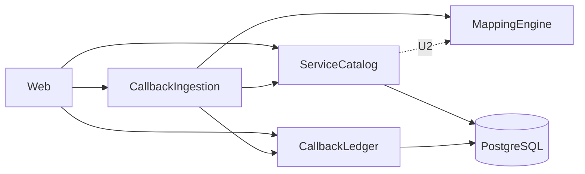

# Thành phần logic — U1 `u1-backend-skeleton`

> Nguồn: `tech-stack-decisions.md`, `functional-spec.md`, `contract-summary.md` (C6) và mã thành phần ADR-001 trong Domain Design; giả định 9, 10 trong `nfr-design-questions.md`. Tài liệu này nối quyết định NFR với Infrastructure Design bằng cái nhìn theo thành phần: nơi từng mẫu NFR được áp dụng, vùng lỗi và phạm vi ảnh hưởng.

## Kiểm kê thành phần logic

| Thành phần logic | Gói / nơi đặt | Trách nhiệm ở U1 | Mẫu NFR áp dụng |
|---|---|---|---|
| ServiceCatalog | `com.tpp.simulator.catalog` | Tạo và đọc Service, ServiceConfigVersion số 1; kiểm tra tối giản (BR1.x) | Giao dịch ở dịch vụ ứng dụng (NFR2.1); ràng buộc duy nhất cho trùng mã (BR1.2) |
| MappingEngine | `com.tpp.simulator.mapping` | Trích ba giá trị bằng một lượt đọc dòng, giữ nguyên văn số, chuẩn hóa timestamp; không trạng thái, không truy cập cơ sở dữ liệu | Đọc dòng, bộ nhớ có chặn trên (NFR1.4); kiểm thử đơn vị trọng tâm (NFR6.3) |
| CallbackIngestion | `com.tpp.simulator.ingestion` | Thứ tự kiểm tra, che header, gọi MappingEngine, yêu cầu CallbackLedger ghi, dựng response | Bộ lọc kích thước đầu vào (NFR3.8); kiểu header đã che (NFR3.3); giao dịch ở dịch vụ ứng dụng (NFR2.1) |
| CallbackLedger | `com.tpp.simulator.ledger` | Ghi Callback, thêm/cập nhật Transaction bằng một câu lệnh, đọc danh sách và chi tiết giao dịch | Cập nhật có điều kiện (NFR2.2, NFR2.3); chỉ mục (NFR1.2); phân trang (NFR1.3) |
| Web | `com.tpp.simulator.web` | Bộ điều khiển REST, bộ lọc kích thước, bộ xử lý lỗi tập trung, header `X-Simulator-Error` | Xử lý lỗi (NFR2.4, NFR3.4); không CORS (NFR3.8) |
| Config | `com.tpp.simulator.config` | Đồng hồ thay thế được, thuộc tính địa chỉ lắng nghe, pool kết nối, Actuator, bộ ghi log | Cấu hình an toàn mặc định (NFR3.1, NFR3.6, NFR3.7, NFR5.4) |
| Lược đồ cơ sở dữ liệu | Tệp `V1__init_schema` | Bốn bảng, khóa, chỉ mục nền (C6) | NFR1.2, NFR2.5, NFR2.6 |

**Phụ thuộc dữ liệu được chấp nhận:** chi tiết giao dịch (BR5.3) cần `configVersionNumber`, `serviceDeleted` và khớp mã dịch vụ không phân biệt hoa thường từ các bảng `services` và `service_config_versions` do ServiceCatalog sở hữu. CallbackLedger đọc chúng bằng phép nối SQL chỉ-đọc, chấp nhận như phụ thuộc mức cơ sở dữ liệu (không phụ thuộc mã) vì đi qua catalog sẽ thêm truy vấn mỗi lần đọc mà không thêm giá trị; phép nối này không đổi dữ liệu của catalog. Kiểm thử phụ thuộc gói chỉ kiểm lệnh import; phụ thuộc dữ liệu này ghi nhận ở đây.

Phụ thuộc một chiều (không vòng, ADR-001, ADR-008): `web` phụ thuộc `ingestion` và `catalog` và `ledger`; `ingestion` phụ thuộc `catalog`, `mapping`, `ledger`; `catalog` phụ thuộc `mapping` (kiểm tra cú pháp ở U2); `mapping` và `ledger` không phụ thuộc thành phần nào của ứng dụng; `config` được mọi gói đọc nhưng không chứa nghiệp vụ. Kiểm bằng một kiểm thử đơn giản đọc các lệnh import, không thêm thư viện.

## Vùng lỗi và phạm vi ảnh hưởng

| Sự cố | Ảnh hưởng | Cách chứa |
|---|---|---|
| PostgreSQL không dùng được | Mọi thao tác ghi và đọc dữ liệu trả 500; `/actuator/health` là `DOWN`; máy chủ vẫn chạy | Pool chờ tối đa 5 giây rồi báo lỗi; tự phục hồi khi cơ sở dữ liệu trở lại (NFR2.4) |
| Lỗi ghi giữa chừng một callback | Cả Callback lẫn Transaction không được ghi; chỉ request đó lỗi | Một giao dịch cơ sở dữ liệu (NFR2.1) |
| Payload lớn hoặc hỏng | Chỉ request đó bị từ chối; không đụng cơ sở dữ liệu | Bộ lọc kích thước và kiểm tra Content-Type/JSON trước khi ghi (BR2.2, BR2.4) |
| Cấu hình dịch vụ sai (đường dẫn không khớp payload) | Callback vẫn được ghi với `MAPPING_ERROR` và nhận response đã cấu hình | Lỗi ánh xạ từng trường độc lập (BR3.3) |
| Lỗi trong MappingEngine không dự đoán | Request đó 500; các request khác không ảnh hưởng | Không trạng thái dùng chung |

Một tiến trình, một cơ sở dữ liệu: vùng lỗi lớn nhất là cả hai; không có dịch vụ nào khác để cô lập.

## Tài nguyên dùng chung

| Tài nguyên | Người dùng | Giới hạn |
|---|---|---|
| Pool kết nối cơ sở dữ liệu (10) | CallbackIngestion, ServiceCatalog, CallbackLedger | Chờ tối đa 5 giây |
| Đồng hồ hệ thống (qua `Clock`) | CallbackIngestion (gán `receivedAt`), ServiceCatalog | Thay được trong kiểm thử |
| Bộ ghi log | Mọi thành phần | Đi qua bộ làm sạch (NFR3.2) |

## Thành phần kỹ thuật bao quanh: README, xây dựng, kiểm thử, CI

| Thành phần | Thiết kế | Yêu cầu |
|---|---|---|
| README của `tpp-simulator-app/` | Điều kiện cần, `docker compose up`, khởi động backend, tạo dịch vụ, gửi callback và truy vấn bằng cURL (kể cả mã hóa `transactionId` có ký tự đặc biệt), cảnh báo địa chỉ lắng nghe và dữ liệu thật, cách sao lưu dữ liệu, giới hạn đã biết của chi tiết giao dịch | NFR5.1 |
| `scripts/verify.ps1` | Chạy `mvn verify` của backend (Spotless, kiểm thử tích hợp Testcontainers, JaCoCo) rồi frontend khi có; dừng ở lỗi đầu tiên và nêu bước lỗi | NFR6.1 |
| Ngưỡng bao phủ | JaCoCo luật `check` 80% line coverage ở phase `verify`, không hạ ngưỡng | NFR6.2 |
| Bộ kiểm thử | Kiểm thử đơn vị cho MappingEngine; kiểm thử tích hợp PostgreSQL thật cho ghi nguyên tử, gom giao dịch, đồng thời, che header, thứ tự kiểm tra và mã lỗi, API; kiểm thử phụ thuộc gói | NFR6.3 |
| Định dạng mã | Spotless với google-java-format ở phase `validate` | NFR6.4 |
| CI | GitHub Actions của `tpp-simulator-app/` chạy cùng các bước; chỉ build và test | NFR6.5 |
| Phụ thuộc | Ghim phiên bản cố định trong `pom.xml`; không sửa bản chuyển Flyway đã áp dụng | NFR6.6 |

## Sources

- `aidlc/spaces/default/intents/261018-tpp-callback-simulator/construction/u1-backend-skeleton/nfr-requirements/tech-stack-decisions.md` (tech-stack-decisions: NFR5.1, NFR6.1 đến NFR6.6)
- `aidlc/spaces/default/intents/261018-tpp-callback-simulator/construction/u1-backend-skeleton/nfr-requirements/performance-requirements.md` (performance-requirements), `security-requirements.md` (security-requirements), `scalability-requirements.md` (scalability-requirements), `reliability-requirements.md` (reliability-requirements) và `observability-requirements.md` (observability-requirements)
- `aidlc/spaces/default/intents/261018-tpp-callback-simulator/construction/u1-backend-skeleton/functional-design/functional-spec.md` (functional-spec)
- `aidlc/spaces/default/intents/261018-tpp-callback-simulator/inception/contract-design/contract-summary.md` (contract-summary: C6)
- `aidlc/spaces/default/intents/261018-tpp-callback-simulator/inception/domain-design/components.md` (components: bốn thành phần backend, ADR-001)
- `aidlc/spaces/default/intents/261018-tpp-callback-simulator/construction/u1-backend-skeleton/nfr-design/nfr-design-questions.md` (giả định 9, 10)

## Assumptions & Open Questions

- Tên gói là đề xuất bám khung dự án `com.tpp.simulator`; Code Generation có thể đổi tên nhưng giữ ranh giới và hướng phụ thuộc.
- `ServiceCatalog` phụ thuộc `MappingEngine` để kiểm tra cú pháp chỉ bắt đầu ở U2; ở U1 chỉ có kiểm tra tối giản (BR1.4).
