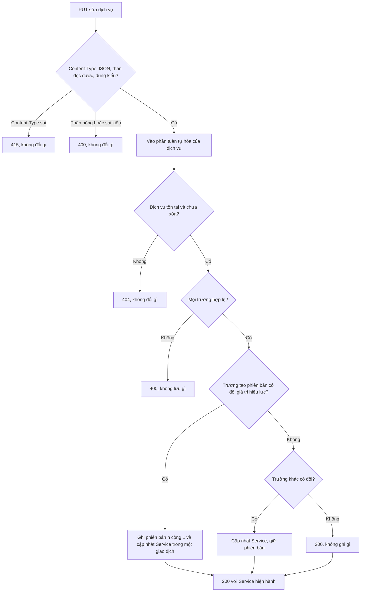
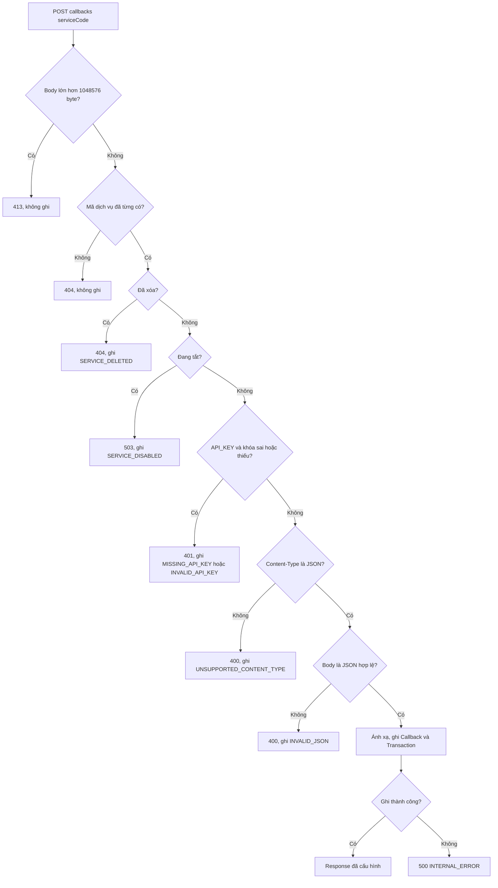
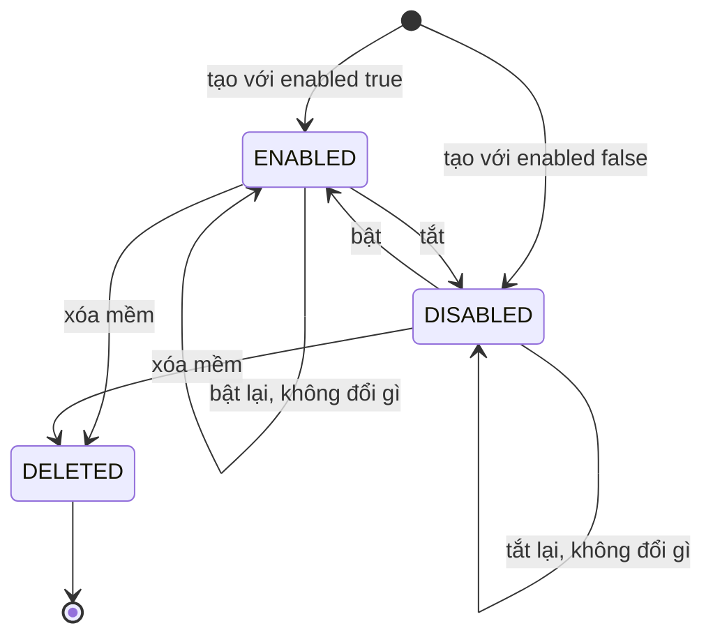
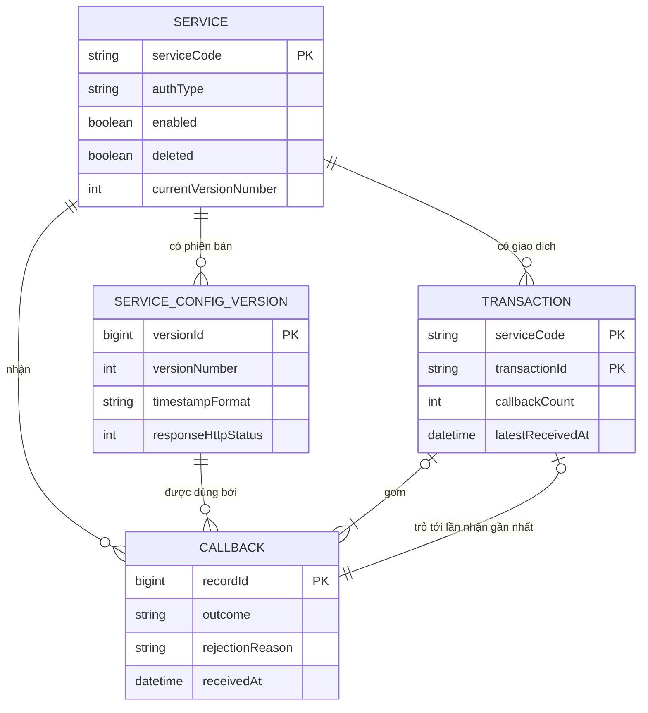

# Đặc tả chức năng — U2 `u2-backend-core`

> Nguồn: `unit-of-work`, `unit-of-work-story-map`, `requirements`, `components` và `contract-summary` (đã sửa ở U1) cùng `openapi.yaml`, `functional-design-questions.md` của U2 (Q1 đến Q8 chọn A, 30 giả định chấp nhận), và thiết kế U1 (`construction/u1-backend-skeleton/functional-design/`). Tài liệu này là nguồn sự thật cho **quy trình từng bước và máy trạng thái**; dữ liệu nằm ở `entities.md`, quy tắc quyết định nằm ở `rules.md`. Các mục "Sơ đồ quan hệ" và "Tóm tắt quy tắc" chỉ là cách nhìn dẫn xuất.
>
> Không có mã, SQL hay tên framework. Ví dụ JSON và cURL ở các mục cuối chỉ để người đọc kiểm chứng được tiêu chí. Quy trình U2 đánh số từ **W11** để không trùng W1 đến W7 của U1; chỗ nào U2 thay thế một quy trình U1, ghi rõ.

## 1. Phạm vi của U2

U2 hoàn thiện bốn thành phần backend trên nền U1 mà không đổi cấu trúc dữ liệu: ServiceCatalog (kiểm tra đầy đủ, sửa, phiên bản, bật/tắt, xóa mềm, liệt kê, khóa API), MappingEngine (bốn định dạng thời gian, cú pháp khi lưu, thử mapping), CallbackIngestion (thứ tự kiểm tra đầy đủ, xác thực khóa API, ghi lần nhận bị từ chối, che header khóa), CallbackLedger (bộ lọc, danh sách callback, chi tiết, đồng thời), cộng tài sản mẫu và công cụ nạp dữ liệu thử.

| Hạng mục | U1 đã làm | U2 làm (quy trình, quy tắc) |
|---|---|---|
| Tạo dịch vụ | Kiểm tra tối giản, chỉ `NONE` và `ISO_8601` | Kiểm tra đầy đủ, `API_KEY`, bốn định dạng thời gian (W11; BR11.x) |
| Sửa, bật/tắt, xóa mềm, liệt kê dịch vụ | Chưa có (chỉ đọc một dịch vụ) | W12 đến W15; BR12.x, BR13.x |
| Phiên bản cấu hình | Chỉ phiên bản số 1 khi tạo | Phiên bản mới khi sửa theo ADR-004 (BR12.4 đến BR12.7) |
| Nhận callback | Đường vui; trả 413, 404, 503, 400 nhưng không ghi lần từ chối; chưa có 401 | Thứ tự kiểm tra đầy đủ, 401, ghi lần từ chối, mã gốc kèm header khi không ghi được (W16 đến W18; BR14.x, BR15.x) |
| Che header | Ba header chuẩn | Thêm header API key hiện hành, kiểm chứng không lộ (BR16.x) |
| Timestamp | `ISO_8601` | Thêm `UNIX_SECONDS`, `UNIX_MILLIS`, `PATTERN` (W19; BR17.x) |
| Thử mapping | Chưa có | W20; BR18.x |
| API đọc | Danh sách giao dịch không lọc, chi tiết giao dịch | Bộ lọc, danh sách callback, chi tiết một lần nhận, kiểm tra tham số (W21 đến W23; BR19.x) |
| Đồng thời | Từng giao dịch cơ sở dữ liệu đúng | Kiểm chứng 50 callback đồng thời (BR20.x) |
| Tài sản mẫu | Không | Ba dịch vụ, payload, script, cURL (W24; BR21.x) |
| Công cụ nạp 100.000 callback | Không | Lệnh riêng, database riêng (W25; BR22.x) |

**Quy tắc U1 được mở rộng hoặc thay thế** (gọi theo tên, mã nằm ở `rules.md` của U1):

| Quy tắc U1 (tên) | Tình trạng ở U2 |
|---|---|
| Từ chối lựa chọn chưa làm (`authType`, `timestampFormat`) | Thay thế bởi BR11.1 |
| Kiểm tra tối giản đường dẫn ánh xạ | Mở rộng bởi BR11.2 |
| Từ chối tham số lọc chưa hỗ trợ ở danh sách giao dịch | Thay thế bởi BR19.1 (và BR19.3) |
| Dịch vụ tắt hoặc đã xóa trả mã nhưng chưa ghi lần từ chối; Content-Type và JSON chưa ghi | Mở rộng bởi BR14.2, BR14.3, BR15.x |
| Che ba header chuẩn | Mở rộng bởi BR16.1 |
| Nhật ký không chứa dữ liệu nhạy cảm | Mở rộng bởi BR14.10 và BR16.2 |
| Timestamp ISO 8601 và timestamp tùy chọn | Mở rộng bởi BR17.x |
| Phân trang cơ bản của danh sách giao dịch | Mở rộng bởi BR19.4 |
| Đồng thời cùng giao dịch (đúng từng giao dịch cơ sở dữ liệu) | Mở rộng bởi BR20.x (kiểm chứng 50 callback) |
| Mã dịch vụ, trùng mã, độ dài trường, response cố định, giá trị mặc định, phiên bản số 1, đọc một dịch vụ, khớp mã không phân biệt hoa thường, 413, `X-Simulator-Error`, `receivedAt`, ghi nguyên tử, ánh xạ `$.a.b.c`, gom giao dịch, chi tiết giao dịch, lắng nghe loopback, định dạng thời gian API | Giữ nguyên |

## 2. Quy trình

### W11 — Tạo dịch vụ (đầy đủ; thay W1 của U1)

Tác nhân: lập trình viên (cURL hoặc giao diện U3).

1. Nhận `POST /api/services`. Content-Type không phải JSON: 415 `UNSUPPORTED_MEDIA_TYPE`. Thân không đọc được hoặc trường sai kiểu: 400 `VALIDATION_FAILED` (BR13.6).
2. Kiểm tra mọi trường và gom **tất cả** lỗi: mã dịch vụ, độ dài trường, response cố định, múi giờ và giá trị mặc định (quy tắc nền của U1), đường dẫn mapping (BR11.2), định dạng thời gian và mẫu (BR11.1, BR11.3, BR11.4), tên header và khóa API (BR11.5, BR11.6, BR11.7). Có lỗi: 400 kèm `fieldErrors`, dừng (BR11.8).
3. Với `authType` là `NONE`: bỏ qua `apiKeyHeaderName` và `apiKeySecret` nếu có, không lưu. Với `API_KEY`: cả hai bắt buộc.
4. Mở một giao dịch cơ sở dữ liệu. Ghi Service (mã đúng chữ gốc, `deleted` false, `currentVersionNumber` 1, tên header và khóa nếu `API_KEY`). Vi phạm khóa duy nhất không phân biệt hoa thường (kể cả mã đã xóa): hủy, 409 `SERVICE_CODE_DUPLICATE`.
5. Ghi ServiceConfigVersion số 1. Hoàn tất giao dịch. Lỗi ghi khác: hủy cả hai, 500 `INTERNAL_ERROR`.
6. Trả 201 với `Service`: có `callbackPath`, `apiKeyConfigured` (true khi `API_KEY`), **không có** khóa (BR13.5).

### W12 — Sửa dịch vụ

Thứ tự kiểm tra chung với W13 (BR13.2): 415 hoặc thân hỏng, rồi 404, rồi lỗi trường. Toàn bộ phần từ bước 3 trở đi chạy **bên trong phần tuần tự hóa theo dịch vụ** (BR12.6), trên trạng thái đã ghi bền mới nhất, dùng chung với bật/tắt (W13) và xóa mềm (W14).

1. Nhận `PUT /api/services/{serviceCode}`. Content-Type sai: 415 `UNSUPPORTED_MEDIA_TYPE`; thân hỏng, không phải object hoặc trường sai kiểu: 400 (BR13.6). Hai kiểm tra này không cần trạng thái dịch vụ nên làm trước khi vào phần tuần tự hóa.
2. Vào phần tuần tự hóa của dịch vụ (BR12.6): từ đây đến khi ghi xong, mọi sửa, bật/tắt và xóa mềm khác của cùng dịch vụ chờ. Đọc trạng thái đã ghi bền mới nhất của dịch vụ ngay khi vào.
3. Khớp dịch vụ không phân biệt hoa thường. Không có hoặc đã xóa: 404 `SERVICE_NOT_FOUND`, dừng, không sinh phiên bản (BR13.4).
4. Kiểm tra giá trị mọi trường như W11 bước 2 (BR11.x), áp dụng việc đổi `authType` và khóa trên `authType` hiện hành vừa đọc (BR12.3): để trống ô khóa giữ khóa cũ; sang `NONE` xóa tên header và khóa; sang `API_KEY` từ `NONE` bắt buộc có khóa. Có lỗi: 400 với mọi lỗi cùng lúc, **không lưu gì** (BR12.2).
5. So sánh các trường tạo phiên bản (đường dẫn, định dạng và mẫu thời gian, múi giờ, mã và nội dung response) với phiên bản hiện hành vừa đọc, theo giá trị hiệu lực (BR12.4).
6. Ghi theo ba nhánh (BR12.5): (a) có trường tạo phiên bản đổi: một giao dịch ghi phiên bản số hiện hành cộng 1 và cập nhật Service; (b) chỉ trường ngoài phiên bản đổi (tên, mô tả, `authType`, tên header, khóa): cập nhật Service, giữ phiên bản; (c) không có gì đổi: không ghi gì, `updatedAt` giữ nguyên. Thao tác sửa **không bao giờ ghi `enabled` hay `deleted`** (BR12.6).
7. Rời phần tuần tự hóa. Trả 200 với `Service` hiện hành. Callback đã ghi không đổi (BR12.7).



### W13 — Bật hoặc tắt dịch vụ

Cùng thứ tự kiểm tra với W12 (BR13.2): 415 hoặc thân hỏng, rồi 404, rồi lỗi trường.

1. Nhận `PUT /api/services/{serviceCode}/enabled` với thân có `enabled`. Content-Type không phải JSON: 415 `UNSUPPORTED_MEDIA_TYPE`. Thân hỏng, không phải object hoặc `enabled` có kiểu sai (không phải boolean): 400 `VALIDATION_FAILED`, field `enabled` hoặc thân hỏng (BR13.6).
2. Vào phần tuần tự hóa của dịch vụ (BR12.6), dùng chung với sửa và xóa mềm. Không có dịch vụ hoặc đã xóa: 404 `SERVICE_NOT_FOUND` (BR13.4).
3. `enabled` vắng: 400 `VALIDATION_FAILED`, field `enabled` (lỗi trường, sau 404).
4. Nếu giá trị khác hiện tại: cập nhật `enabled` và `updatedAt`; nếu giống: không đổi gì. Không bao giờ sinh phiên bản (BR13.2).
5. Rời phần tuần tự hóa. Trả 200 với `Service` hiện hành.

### W14 — Xóa mềm dịch vụ

1. Nhận `DELETE /api/services/{serviceCode}`. Vào phần tuần tự hóa của dịch vụ (BR12.6), dùng chung với sửa và bật/tắt. Không có hoặc đã xóa (kể cả xóa lại): 404.
2. Đặt `deleted` true và `updatedAt`; giữ nguyên mọi thứ khác (BR13.3). Callback, Transaction và phiên bản không bị chạm. Một lần sửa tới sau bước này thấy dịch vụ đã xóa và trả 404.
3. Trả 204 không thân. Từ giờ URL callback trả 404 (lần nhận được ghi, W18), danh sách mặc định không còn dịch vụ, và mã không dùng lại được.

### W15 — Danh sách dịch vụ

1. Nhận `GET /api/services` với `includeDeleted` tùy chọn (BR13.1). Vắng hoặc rỗng (`includeDeleted=`): coi như false. Giá trị không rỗng khác true hoặc false: 400.
2. Trả mảng `Service` sắp theo `serviceCode` tăng dần không phân biệt hoa thường; dịch vụ đã xóa chỉ có khi `includeDeleted` là true.

### W16 — Nhận callback (đầy đủ; thay W2 của U1)

Tác nhân: hệ thống ngân hàng hoặc cURL. Mọi nhánh lỗi do ứng dụng sinh có header `X-Simulator-Error`. Thứ tự là cố định (BR14.2).

1. Nhận `POST /callbacks/{serviceCode}`. Ghi `receivedAt` bằng đồng hồ server ngay lúc bắt đầu.
2. Body lớn hơn 1.048.576 byte: 413 `PAYLOAD_TOO_LARGE`, dừng, không ghi.
3. Đọc **một lần** ảnh dịch vụ (BR14.1): đã xóa, bật/tắt, `authType`, tên header khóa, khóa, phiên bản hiện hành. Không đọc được vì kho dữ liệu hỏng: 500 `INTERNAL_ERROR`, không ghi (BR14.9).
4. Mã chưa từng có (không phân biệt hoa thường): 404 `SERVICE_NOT_FOUND`, không ghi.
5. Đã xóa: từ chối 404 `SERVICE_NOT_FOUND`, lý do `SERVICE_DELETED`, chuyển W18. Nếu không: tắt: từ chối 503 `SERVICE_DISABLED`, lý do `SERVICE_DISABLED`, chuyển W18 (BR14.3).
6. Dịch vụ `API_KEY`: chạy W17. Sai hoặc thiếu: từ chối 401 `UNAUTHORIZED`, chuyển W18. Dịch vụ `NONE` bỏ qua bước này (BR14.5).
7. Content-Type không phải `application/json`: từ chối 400 `UNSUPPORTED_CONTENT_TYPE`, chuyển W18.
8. Body rỗng hoặc không phải đúng một giá trị JSON: từ chối 400 `INVALID_JSON`, chuyển W18.
9. Ánh xạ bằng phiên bản trong ảnh (quy trình ánh xạ nền của U1, với bốn định dạng thời gian ở W19), được ba kết quả trường và `outcome` `SUCCESS` hoặc `MAPPING_ERROR`. Ánh xạ lỗi không đổi response (BR14.7).
10. Che header (BR16.1) rồi dựng Callback.
11. Mở một giao dịch cơ sở dữ liệu: ghi Callback; nếu `transactionId` hợp lệ thì tạo hoặc cập nhật Transaction (cập nhật có điều kiện theo (`receivedAt`, `recordId`), quy trình gom giao dịch nền của U1); hoàn tất. Lỗi bất kỳ: hủy cả hai, trả 500 `INTERNAL_ERROR` (BR14.8).
12. Trả response đã cấu hình của phiên bản đã dùng: đúng mã HTTP và body, `Content-Type: application/json`, không có `X-Simulator-Error`.
13. Ghi đúng một dòng nhật ký không chứa dữ liệu nhạy cảm (BR14.10); khi có lỗi ghi ở bước 3 hoặc 11 (hoặc ở W18), dòng mức ERROR thay cho dòng INFO.



Bảng kết quả của W16:

| Điều kiện | HTTP | Mã lỗi (`X-Simulator-Error` và `error`) | `rejectionReason` ghi | Ghi Callback? |
|---|---|---|---|---|
| Body quá 1.048.576 byte | 413 | `PAYLOAD_TOO_LARGE` | — | Không |
| Mã dịch vụ chưa từng có | 404 | `SERVICE_NOT_FOUND` | — | Không |
| Dịch vụ đã xóa | 404 | `SERVICE_NOT_FOUND` | `SERVICE_DELETED` | Có (`REJECTED`) |
| Dịch vụ tắt | 503 | `SERVICE_DISABLED` | `SERVICE_DISABLED` | Có |
| Thiếu khóa API | 401 | `UNAUTHORIZED` | `MISSING_API_KEY` | Có |
| Sai khóa API (kể cả nhiều giá trị) | 401 | `UNAUTHORIZED` | `INVALID_API_KEY` | Có |
| Content-Type không phải JSON | 400 | `UNSUPPORTED_CONTENT_TYPE` | `UNSUPPORTED_CONTENT_TYPE` | Có |
| Body rỗng hoặc JSON hỏng | 400 | `INVALID_JSON` | `INVALID_JSON` | Có |
| Chấp nhận, ánh xạ tốt hoặc lỗi | Theo cấu hình | Không có | — | Có (`SUCCESS` hoặc `MAPPING_ERROR`) |
| Lỗi ghi callback được chấp nhận | 500 | `INTERNAL_ERROR` | — | Không (hủy cả hai) |
| Không đọc được trạng thái dịch vụ | 500 | `INTERNAL_ERROR` | — | Không |
| Lỗi ghi lần từ chối | Mã từ chối gốc | Mã lỗi gốc, thêm header `X-Simulator-Record-Failed: true` | — | Không ghi được |

Bảng đối chiếu tên kiểm tra với số bước của hai nơi (các quy tắc và quy trình khác gọi kiểm tra **theo tên**, không theo số bước, để không lẫn hai cách đánh số):

| Tên kiểm tra | Bước ở BR14.2 | Bước ở W16 | Lý do từ chối ghi |
|---|---|---|---|
| Kích thước | 1 | 2 | — (không ghi) |
| Mã chưa từng có | 2 | 3 (đọc ảnh) và 4 | — (không ghi) |
| Đã xóa | 3 | 5 | `SERVICE_DELETED` |
| Tắt | 4 | 5 | `SERVICE_DISABLED` |
| Khóa API | 5 | 6 | `MISSING_API_KEY`, `INVALID_API_KEY` |
| Content-Type | 6 | 7 | `UNSUPPORTED_CONTENT_TYPE` |
| JSON | 7 | 8 | `INVALID_JSON` |
| Ánh xạ và ghi | 8 | 9 đến 12 | — (chấp nhận) |

Năm kiểm tra đã xóa, tắt, khóa API, Content-Type, JSON là các kiểm tra mà khi không qua thì lần nhận bị từ chối được ghi (W18, BR15.1).

### W17 — So khớp khóa API

Chỉ chạy cho dịch vụ `API_KEY`, dùng tên header và khóa trong ảnh dịch vụ (BR14.4).

1. Tìm trong request các header có tên trùng `apiKeyHeaderName` không phân biệt hoa thường.
2. Không có header nào, hoặc giá trị rỗng (sau khi giao thức bỏ khoảng trắng đầu cuối): kết quả `MISSING_API_KEY`.
3. Có nhiều hơn một giá trị (header lặp lại): kết quả `INVALID_API_KEY`.
4. Một giá trị: so với khóa đã lưu chính xác từng ký tự, phân biệt hoa thường, bằng phép so sánh thời gian không phụ thuộc vị trí khác biệt đầu tiên. Khác nhau: `INVALID_API_KEY`; giống: cho qua.
5. Không bước nào ghi khóa hay giá trị header vào nhật ký hoặc thân lỗi (BR16.2).

| Tình huống (dịch vụ `X-Api-Key`, khóa `k1`) | Kết quả |
|---|---|
| `X-Api-Key: k1` | Qua |
| `x-api-key: k1` | Qua (tên không phân biệt hoa thường) |
| `X-Api-Key: K1` | 401, `INVALID_API_KEY` |
| `X-Api-Key: sai` | 401, `INVALID_API_KEY` |
| Không có header | 401, `MISSING_API_KEY` |
| `X-Api-Key:` giá trị rỗng | 401, `MISSING_API_KEY` |
| Hai header `X-Api-Key`, một đúng một sai | 401, `INVALID_API_KEY` |
| Dịch vụ `NONE`, không header nào | Không bị từ chối vì xác thực |

### W18 — Ghi lần nhận bị từ chối

Chạy khi W16 từ chối ở một trong năm kiểm tra đã xóa, tắt, khóa API, Content-Type, JSON (đối chiếu số bước ở bảng sau W16), hoặc khi công cụ nạp mô phỏng một lần từ chối.

1. Giải mã body theo UTF-8 và quyết định hình thức lưu **một lần, trước khi ghi** (BR15.4). Nếu là đúng một giá trị JSON hợp lệ và lưu trung thực được ở định dạng JSON của kho dữ liệu (không có chuỗi thoát U+0000, không có chuỗi thoát nửa cặp thay thế, không có số vượt miền số của kho): `payloadJson` (body đúng chữ `null` cũng ở đây, dưới dạng giá trị JSON null). Nếu không: `payloadRawText` (byte không hợp lệ và ký tự NUL thay bằng U+FFFD; body rỗng là chuỗi rỗng). Không bao giờ cả hai và không bao giờ thử ghi lần hai bằng hình thức còn lại.
2. Che header (BR16.1), kể cả header khóa đã gửi sai.
3. Dựng Callback `REJECTED` (BR15.2): `rejectionReason`, `httpStatusReturned` và `responseStatusReturned` là mã từ chối, `responseBodyReturned` là thân lỗi đã (sẽ) trả, `configVersionId` là phiên bản hiện hành của ảnh, `transactionId`, `status`, `businessTimestampUtc` để trống, `mappingFieldResults` rỗng.
4. Ghi trong một giao dịch cơ sở dữ liệu **riêng** (BR15.5). Không chạm Transaction (BR15.3).
5. Thành công: trả response từ chối của BR14.6, ghi đúng một dòng nhật ký INFO (BR14.10).
6. Lỗi ghi: trả **cùng** response từ chối đó, thêm header `X-Simulator-Record-Failed: true`, ghi đúng một dòng nhật ký mức ERROR thay cho dòng INFO, theo tập trường của BR14.10 (mã dịch vụ đã làm sạch, lý do, mã HTTP gốc, lớp lỗi, mã lỗi của kho dữ liệu nếu có; không body, không khóa) (BR15.6).

### W19 — Chuẩn hóa timestamp theo bốn định dạng (mở rộng ánh xạ nền của U1)

Đầu vào: giá trị tại `timestampPath` đã được tìm thấy (các trường hợp không tìm thấy, null, rỗng đã là cảnh báo theo BR17.5), `timestampFormat`, `timestampPattern`, `defaultTimeZone`. Đầu ra: thời điểm UTC hoặc lỗi của riêng trường timestamp.

1. Object hoặc mảng: lỗi `WRONG_TYPE`, dừng. Boolean: lỗi `UNPARSEABLE`, dừng (mọi định dạng).
2. `ISO_8601`: chuỗi ISO 8601 có offset hoặc `Z` đổi sang UTC; không múi giờ thì dùng `defaultTimeZone`; số hay chuỗi không phải ISO: `UNPARSEABLE` (quy tắc nền của U1).
3. `UNIX_SECONDS` hoặc `UNIX_MILLIS`: nhận số JSON (theo giá trị thập phân chính xác) hoặc chuỗi gồm một hay nhiều chữ số, tùy chọn theo sau bởi dấu chấm và ít nhất một chữ số thập phân (BR17.1). Chuỗi sai dạng (kể cả `"1760850000."` và `".5"`) hoặc số âm: `UNPARSEABLE`. Kiểm tra khoảng 1970 đến 2100 theo bậc độ lớn **trước** khi khai triển số mũ hay đổi đơn vị (bước 5); sau đó cắt đến micro giây và quy đổi theo đơn vị.
4. `PATTERN`: lấy chuỗi (hoặc văn bản gốc của số JSON), khớp **toàn bộ** mẫu, phân tích chặt; múi giờ trong mẫu ưu tiên hơn `defaultTimeZone`; ngày giờ không tồn tại hoặc ký tự thừa: `UNPARSEABLE` (BR17.3).
5. Với Unix, nếu thời điểm kết quả ngoài 1970-01-01T00:00:00Z đến 2100-01-01T00:00:00Z (tính cả hai đầu): `UNPARSEABLE` (BR17.2). Việc kiểm tra này làm trước khi khai triển số mũ, nên số có số mũ rất lớn như `1e999999999` ra `UNPARSEABLE` ngay mà không khai triển và không bao giờ thành 500 (BR17.1, BR14.7). Với mọi định dạng, năm UTC ngoài 1 đến 9999: `UNPARSEABLE`.
6. Giờ địa phương trùng hoặc không tồn tại do chuyển mùa: lấy offset sớm hơn, hoặc dời tới theo độ lệch (BR17.4).
7. Kết quả hợp lệ là ISO 8601 UTC đến micro giây. Lỗi của timestamp chỉ làm `outcome` thành `MAPPING_ERROR`; không ảnh hưởng transactionId, status và việc vào giao dịch (BR17.5).

Bảng ví dụ kiểm chứng (múi giờ mặc định `Asia/Ho_Chi_Minh`, GMT+7):

| Định dạng | Giá trị nhận | Kết quả |
|---|---|---|
| `ISO_8601` | `"2026-10-19T10:00:00+07:00"` | `2026-10-19T03:00:00Z` |
| `ISO_8601` | `"2026-10-19T10:00:00"` | `2026-10-19T03:00:00Z` (dùng múi giờ mặc định) |
| `UNIX_SECONDS` | `1760850000` hoặc `"1760850000"` | `2025-10-19T05:00:00Z` |
| `UNIX_SECONDS` | `1760850000.123` | `2025-10-19T05:00:00.123Z` |
| `UNIX_MILLIS` | `1760850000000` | `2025-10-19T05:00:00Z` |
| `UNIX_MILLIS` | `1760850000000` nhưng cấu hình `UNIX_SECONDS` | `UNPARSEABLE` (ra năm xa hơn 2100) |
| `UNIX_SECONDS` | `"abc"`, `-5`, `true` | `UNPARSEABLE` |
| `UNIX_SECONDS` | `"1760850000.5"` | `2025-10-19T05:00:00.500Z` |
| `UNIX_SECONDS` | `"1760850000."` hoặc `".5"` (chuỗi) | `UNPARSEABLE` (dấu chấm không kèm chữ số thập phân; không có chữ số trước dấu chấm) |
| `UNIX_SECONDS` | `1e999999999` (số JSON) | `UNPARSEABLE` (ngoài 1970 đến 2100, kiểm tra trước khi khai triển số mũ; không 500) |
| `UNIX_SECONDS` | `1e-999999999` (số JSON) | `1970-01-01T00:00:00Z` (cắt về 0 micro giây, hợp lệ ở biên; không khai triển) |
| `UNIX_SECONDS` | `{"a":1}` hoặc `[1]` | `WRONG_TYPE` |
| `PATTERN` `yyyy-MM-dd HH:mm:ss` | `"2026-10-19 10:00:00"` | `2026-10-19T03:00:00Z` |
| `PATTERN` `yyyy-MM-dd HH:mm:ss` | `"2026-02-30 10:00:00"` | `UNPARSEABLE` (ngày không tồn tại) |
| `PATTERN` `yyyy-MM-dd HH:mm:ss` | `"2026-10-19 10:00:00 extra"` | `UNPARSEABLE` (dư ký tự) |
| `PATTERN` `dd/MMM/yyyy HH:mm Z` | `"19/Oct/2026 10:00 +0700"` | `2026-10-19T03:00:00Z` (offset trong mẫu) |
| `PATTERN` `yyyy-MM-dd` | (khi lưu) | 400, field `timestampPattern` (thiếu giờ, phút) |

### W20 — Thử mapping

1. Nhận `POST /api/mapping-tests`. Content-Type sai: 415; thân hỏng hoặc sai kiểu: 400 (BR13.6).
2. Kiểm tra cấu hình trong yêu cầu bằng cùng quy tắc như khi lưu (BR18.2): trường bắt buộc, đường dẫn (BR11.2), định dạng (BR11.1), mẫu (BR11.3), múi giờ. Có lỗi: 400 kèm mọi `fieldErrors`, không chạy.
3. `sampleJson` dài hơn 1.048.576 byte: 400, field `sampleJson`. Không phải đúng một giá trị JSON hợp lệ (kể cả rỗng): 200 với `sampleJsonValid` false và `sampleJsonError` (loại và vị trí lỗi, không lặp nội dung), dừng (BR18.3).
4. Chạy cùng MappingEngine như W16 bước 9 trên giá trị JSON mẫu với cấu hình trong yêu cầu (BR18.1, BR18.4). Không chạm cơ sở dữ liệu.
5. Trả 200 với `sampleJsonValid` true và ba kết quả (`transactionId`, `status`, `timestamp`; `timestamp` vắng khi không có `timestampPath`).

### W21 — Danh sách giao dịch (có lọc; thay W5 của U1)

1. Nhận `GET /api/transactions` với `serviceCode`, `transactionId`, `status`, `receivedFrom`, `receivedTo`, `page`, `size`.
2. Kiểm tra tham số (BR19.3) và gom mọi lỗi. Giá trị rỗng của mọi tham số (`receivedFrom=`, `page=`, `size=`...) coi như vắng, không phải lỗi; chỉ giá trị không rỗng mà không hợp lệ mới bị 400: định dạng hoặc múi giờ của `receivedFrom`, `receivedTo`; cận dưới hiệu lực của `receivedFrom` lớn hơn cận trên hiệu lực của `receivedTo` (lỗi ở `receivedTo`); `page`, `size`; tham số lặp. Có lỗi: 400.
3. Áp bộ lọc bằng AND (BR19.1): dịch vụ khớp trọn mã không phân biệt hoa thường (kể cả đã xóa); `transactionId` và `status` chứa chuỗi không phân biệt hoa thường; thời gian theo `latestReceivedAt` tính cả hai đầu ở micro giây, nhận phần thập phân của giây, và giá trị không có phần thập phân nghĩa là cả giây (`receivedFrom` từ `.000000`, `receivedTo` đến `.999999`); giá trị rỗng là không lọc.
4. Sắp `latestReceivedAt` giảm dần rồi `latestCallbackId` giảm dần; phân trang (BR19.4); trả `items`, `page`, `size`, `totalItems`, `totalPages`. Trang vượt cuối: 200 với `items` rỗng.

### W22 — Danh sách callback

1. Nhận `GET /api/callbacks` với `serviceCode`, `transactionId`, `outcome`, `rejectionReason`, `receivedFrom`, `receivedTo`, `page`, `size`.
2. Kiểm tra tham số như W21 bước 2, thêm `outcome` và `rejectionReason` ngoài danh sách (BR19.3).
3. Áp bộ lọc bằng AND (BR19.2); thời gian theo `receivedAt` với cùng ngữ nghĩa giây và phần thập phân như W21 bước 3. `rejectionReason` kèm `outcome` khác `REJECTED`: kết quả rỗng, không lỗi.
4. Sắp `receivedAt` giảm dần rồi `recordId` giảm dần; phân trang; mỗi dòng theo BR19.5, gồm cả `SUCCESS`, `MAPPING_ERROR`, `REJECTED`.

### W23 — Chi tiết một lần nhận

1. Nhận `GET /api/callbacks/{recordId}`. `recordId` không phải số nguyên 64 bit: 400 `VALIDATION_FAILED`.
2. Không có (kể cả `recordId` nhỏ hơn 1): 404 `CALLBACK_NOT_FOUND`.
3. Trả `CallbackDetail` (BR19.6): header đã che, đúng một trong `payloadJson` và `payloadRawText`, kết quả ánh xạ (đối tượng rỗng khi `REJECTED`), response đã trả, `configVersionNumber`.

### W24 — Tạo ba dịch vụ mẫu bằng script

1. Người dùng khởi động PostgreSQL và backend, rồi chạy script (PowerShell hoặc bash). Địa chỉ backend mặc định `http://127.0.0.1:8080`, đổi được bằng tham số.
2. Với mỗi tệp `<mã>.service.json` trong `docs/samples/`, gọi `POST /api/services` (BR21.4).
3. 201: in "đã tạo". 409 `SERVICE_CODE_DUPLICATE`: in "đã tồn tại (hoặc đã bị xóa)" và tiếp tục. Phản hồi khác hoặc không kết nối được: ghi nhận lỗi, vẫn thử các dịch vụ còn lại.
4. Kết thúc: mã thoát 0 khi mọi dịch vụ đã tạo hoặc đã tồn tại; khác 0 khi có lỗi khác. Script không sửa, không xóa dịch vụ nào.
5. Sau đó người dùng chạy các lệnh cURL mẫu trong README của thư mục để gửi payload hợp lệ và payload lỗi (BR21.2, BR21.3).

### W25 — Nạp dữ liệu thử 100.000 callback

Tác nhân: lập trình viên chạy lệnh riêng, không bao giờ lúc khởi động (BR22.1). Cách đo NFR1 **không** được chốt ở đây.

1. Đọc tham số `--callbacks` (100000), `--seed` (hằng số cố định), `--days` (30), `--services` (3), `--append` và tên database đích (BR22.3). Sai: dừng, thông báo, mã thoát khác 0.
2. Nếu database đích trùng database thật: dừng. Nếu chưa có: tạo; không tạo được: dừng. Bảo đảm lược đồ cùng phiên bản với ứng dụng (BR22.2).
3. Nếu dịch vụ `LOAD_01` trở đi đã có và không có `--append`: dừng, không ghi gì (BR22.5). Ngược lại tạo các dịch vụ `LOAD_xx` với nhiều cấu hình khác nhau; với `--append`, dịch vụ `LOAD_01` đến `LOAD_<--services>` đã có thì dùng lại và bỏ qua, chỉ tạo các dịch vụ còn thiếu (BR22.5).
4. Sinh lần lượt các lần nhận theo hình dạng của BR22.4 (khoảng 4 callback mỗi giao dịch, 85% `SUCCESS`, 10% `MAPPING_ERROR`, 5% `REJECTED` đủ sáu lý do, payload khoảng 1 KB). Với mỗi lần nhận, công cụ chọn `receivedAt` rải đều trong `--days` ngày gần nhất rồi đưa nó vào lối vào nội bộ của logic nhận callback (chỉ công cụ dùng; endpoint HTTP thật luôn tự gán `receivedAt`, BR22.1). Mỗi lần đi qua đúng logic nhận callback (W16 từ các kiểm tra trạng thái dịch vụ trở đi, W18, W19) nhưng không qua HTTP.
5. Xong: in số Callback, số giao dịch, thời gian nạp, mã thoát 0. Lỗi giữa chừng: dừng, in số đã ghi và lý do, mã thoát khác 0; dữ liệu đã ghi giữ nguyên.

## 3. Máy trạng thái

### Service (đầy đủ)



`DELETED` là trạng thái cuối và một chiều: không sửa, không bật/tắt, không xóa lại (đều 404); mã không dùng lại được; lịch sử vẫn tra cứu được. Sửa cấu hình không đổi trạng thái `ENABLED` hay `DISABLED` và không bao giờ ghi `enabled` hay `deleted`. Các chuyển trạng thái trên và thao tác sửa của cùng một dịch vụ chạy trong cùng một phần tuần tự hóa theo dịch vụ (BR12.6), nên một lần sửa tới sau khi dịch vụ chuyển sang `DELETED` thấy trạng thái cuối và trả 404.

### Phiên bản cấu hình

Một dịch vụ có dãy phiên bản liên tục 1, 2, 3...; mỗi phiên bản bất biến. Mỗi lần sửa có trường tạo phiên bản đổi giá trị hiệu lực thì thêm đúng một phiên bản cuối dãy (sơ đồ ở W12). Không bao giờ sửa, xóa hay đánh số lại phiên bản đã có. Callback tham chiếu cố định một phiên bản.

### Callback

Callback không có chuyển trạng thái: ghi một lần với `outcome` cuối cùng (`SUCCESS`, `MAPPING_ERROR`, hoặc `REJECTED`) và không bao giờ sửa hay xóa. Sơ đồ quyết định của `outcome` là sơ đồ ở W16.

### Transaction

Không đổi so với U1: callback đầu tiên tạo giao dịch; mỗi callback được chấp nhận có `transactionId` hợp lệ tăng `callbackCount` thêm 1; trạng thái `latest*` chỉ thay khi cặp (`receivedAt`, `recordId`) của callback đang ghi lớn hơn cặp đang lưu. Lần nhận bị từ chối không bao giờ vào giao dịch. Với 50 callback đồng thời cùng cặp, kết quả cuối là một giao dịch có `callbackCount` bằng 50 và `latest*` của callback có cặp lớn nhất (BR20.x).

## 4. Mã lỗi và header

Bảng này cập nhật bảng mã lỗi của U1 cho các nơi U2 dùng. Mọi lỗi do ứng dụng sinh ra có `X-Simulator-Error` bằng đúng giá trị `error`.

| Mã (`error`) | HTTP | Nơi dùng ở U2 |
|---|---|---|
| `VALIDATION_FAILED` | 400 | Tạo, sửa dịch vụ (BR11.x), bật/tắt (BR13.2), thử mapping (BR18.x), `includeDeleted` sai của danh sách dịch vụ (BR13.1), tham số danh sách giao dịch và callback (BR19.3), `recordId` sai (BR19.6) |
| `UNSUPPORTED_CONTENT_TYPE`, `INVALID_JSON` | 400 | Endpoint callback (BR14.2) |
| `UNAUTHORIZED` | 401 | Endpoint callback, thiếu hoặc sai khóa (BR14.4) |
| `SERVICE_NOT_FOUND` | 404 | Endpoint callback (mã chưa từng có, đã xóa), sửa, bật/tắt, xóa dịch vụ không có hoặc đã xóa (BR13.4) |
| `CALLBACK_NOT_FOUND` | 404 | Chi tiết một lần nhận (BR19.6) |
| `TRANSACTION_NOT_FOUND` | 404 | Chi tiết giao dịch (nền U1) |
| `SERVICE_CODE_DUPLICATE` | 409 | Tạo dịch vụ (nền U1) |
| `PAYLOAD_TOO_LARGE` | 413 | Endpoint callback (BR14.2) |
| `UNSUPPORTED_MEDIA_TYPE` | 415 | Tạo, sửa, bật/tắt dịch vụ và thử mapping có Content-Type không phải JSON (BR13.2, BR13.6) |
| `INTERNAL_ERROR` | 500 | Lỗi ghi callback được chấp nhận (BR14.8), không đọc được trạng thái dịch vụ (BR14.9), lỗi ghi hoặc đọc khi tạo, sửa, bật/tắt, xóa dịch vụ, khi liệt kê callback và khi thử mapping |
| `SERVICE_DISABLED` | 503 | Endpoint callback (BR14.3) |

Header phụ: `X-Simulator-Record-Failed: true` chỉ xuất hiện trên response từ chối 400, 401, 404 (dịch vụ đã xóa) và 503 của endpoint callback khi lần nhận bị từ chối không ghi được (BR15.6).

Mã lỗi ánh xạ từng trường (trong `FieldResult`, không phải mã HTTP): `NOT_FOUND`, `EMPTY`, `WRONG_TYPE`, `TOO_LONG`, `PAYLOAD_NOT_OBJECT`, `UNPARSEABLE`.

## 5. Thay đổi hợp đồng bắt buộc cho Code Generation

Tất cả thay đổi dưới đây tương thích (thêm, không đổi nghĩa thứ đã có). Chúng phải được thực hiện trong `tpp-simulator-app/docs/api/openapi.yaml` ở Code Generation và ghi vào nhật ký thay đổi của tệp.

| # | Thay đổi | Bắt buộc? |
|---|---|---|
| 1 | Thêm header `X-Simulator-Record-Failed` (kiểu chuỗi, giá trị `true`) vào response 400, 401, 404, 503 của `POST /callbacks/{serviceCode}`, mô tả "có mặt khi lần nhận bị từ chối không ghi được" (Q1 A, BR15.6) | **Có** |
| 2 | Cập nhật mô tả `POST /callbacks/{serviceCode}`: thứ tự đầy đủ (BR14.2), 401 `UNAUTHORIZED` đã hiệu lực, lần nhận bị từ chối được ghi (bỏ câu "ở U1 chưa được lưu") | Có |
| 3 | Bỏ ghi chú "chưa triển khai ở U1" và đổi `x-unit` của `GET /api/services`, `PUT` và `DELETE /api/services/{serviceCode}`, `PUT .../enabled`, `POST /api/mapping-tests`, `GET /api/callbacks`, `GET /api/callbacks/{recordId}`; bỏ ghi chú "hiện bị từ chối" của tham số lọc `GET /api/transactions` | Có |
| 4 | Mô tả ràng buộc mới trong schema cấu hình: đường dẫn mapping (BR11.2), `apiKeyHeaderName` (BR11.5), `apiKeySecret` 1 đến 256 ký tự ASCII in được (BR11.6), `timestampPattern` (BR11.3), bỏ câu "U1 chỉ chấp nhận NONE / ISO_8601" | Có |
| 5 | Bổ sung phản hồi còn thiếu, đủ để hợp đồng khớp hành vi đã thiết kế: (a) 400 `VALIDATION_FAILED` cho `PUT .../enabled`, `PUT` sửa dịch vụ và `POST /api/mapping-tests`; (b) 415 `UNSUPPORTED_MEDIA_TYPE` cho `PUT .../enabled`, `PUT` sửa dịch vụ và `POST /api/mapping-tests`; (c) 400 `VALIDATION_FAILED` cho `GET /api/services` khi `includeDeleted` sai (BR13.1); (d) 400 cho `GET /api/callbacks/{recordId}` khi `recordId` sai; (e) 500 `INTERNAL_ERROR` cho `PUT /api/services/{serviceCode}`, `DELETE /api/services/{serviceCode}`, `PUT .../enabled`, `GET /api/callbacks` và `POST /api/mapping-tests`; (f) `maxLength` của `sampleJson` (1.048.576 byte) | Có |
| 6 | Mô tả `CallbackDetail`: lần nhận `REJECTED` có `payloadJson` hoặc `payloadRawText` (đúng một; `payloadRawText` vắng nghĩa là payload nằm ở `payloadJson`, kể cả khi là `null`, BR15.4), `mappingFieldResults` là đối tượng rỗng, `configVersionNumber` là phiên bản hiện hành lúc nhận | Có |
| 7 | Ghi nhật ký thay đổi của U2 vào đầu `openapi.yaml`, nêu `UNAUTHORIZED` hiệu lực và header mới | Có |

Không có thay đổi gây gãy: không đổi đường dẫn, không đổi tên hay kiểu trường đã có, không thêm trường bắt buộc. Portal (U3, U4) bỏ qua header lạ và trường lạ, nên tương thích.

## 6. Sơ đồ quan hệ (dẫn xuất từ `entities.md`)



Số lượng của hai quan hệ giữa Transaction và Callback: "gom" là mỗi Callback thuộc 0 hoặc 1 Transaction, mỗi Transaction có một hay nhiều Callback; "trỏ tới lần nhận gần nhất" là mỗi Transaction trỏ tới đúng một Callback (lần nhận gần nhất của nó) và mỗi Callback là lần nhận gần nhất của 0 hoặc 1 Transaction. Callback `REJECTED` không thuộc Transaction nào và không là lần nhận gần nhất của Transaction nào; quan hệ "gom" chỉ áp dụng cho Callback `SUCCESS` hoặc `MAPPING_ERROR` có `transactionId` hợp lệ.

## 7. Tóm tắt quy tắc (dẫn xuất từ `rules.md`)

| Việc | Quy tắc chính |
|---|---|
| Kiểm tra cấu hình khi lưu | BR11.1 đến BR11.8 |
| Sửa dịch vụ và phiên bản cấu hình | BR12.1 đến BR12.7 |
| Vòng đời và API quản lý dịch vụ | BR13.1 đến BR13.6 |
| Thứ tự kiểm tra, xác thực, mã từ chối, lỗi ghi | BR14.1 đến BR14.10 |
| Ghi lần nhận bị từ chối | BR15.1 đến BR15.6 |
| Che header, không lộ khóa | BR16.1, BR16.2 |
| Timestamp bốn định dạng | BR17.1 đến BR17.5 |
| Thử mapping | BR18.1 đến BR18.4 |
| Tra cứu, bộ lọc, phân trang, chi tiết, hiệu năng | BR19.1 đến BR19.7 |
| Đồng thời | BR20.1 đến BR20.3 |
| Tài sản mẫu | BR21.1 đến BR21.5 |
| Công cụ nạp dữ liệu thử | BR22.1 đến BR22.5 |

## 8. Tài sản mẫu (US2.11)

Cấu hình ba dịch vụ mẫu (BR21.1), mỗi dịch vụ một tệp `<mã>.service.json` đúng thân của `POST /api/services`:

| Dịch vụ | Xác thực | Định dạng thời gian | Đường dẫn (transactionId / status / timestamp) | Response |
|---|---|---|---|---|
| `THU_HO` | `NONE` | `ISO_8601` | `$.transId` / `$.code` / `$.time` | 200, thân có `code` bằng `00` |
| `CHI_HO` | `API_KEY`, header `X-Api-Key`, khóa giả công khai `sample-key-chi-ho` | `PATTERN` `yyyy-MM-dd HH:mm:ss`, múi giờ `Asia/Ho_Chi_Minh` | `$.processId` / `$.status` / `$.date` | 200, thân có `status` bằng `OK` |
| `BIEN_DONG_SO_DU` | `NONE` | `UNIX_MILLIS` | `$.trnId` / `$.stage` / `$.dateTime` | 202, thân có `received` bằng `true` |

Hai payload mỗi dịch vụ (BR21.2), tên tệp `<mã>.payload-valid.json` và `<mã>.payload-faulty.json`:

| Tệp | Nội dung | Kết quả mong đợi |
|---|---|---|
| `THU_HO.payload-valid.json` | `{"transId":"THUHO-0001","code":"00","time":"2026-10-19T10:00:00+07:00"}` | `SUCCESS`; transactionId `THUHO-0001`, status `00`, timestamp `2026-10-19T03:00:00Z` |
| `THU_HO.payload-faulty.json` | `{"transId":"THUHO-0002","time":"19-10-2026"}` | `MAPPING_ERROR`: status `NOT_FOUND`, timestamp `UNPARSEABLE`; vẫn vào giao dịch `THUHO-0002`; response `200` đã cấu hình |
| `CHI_HO.payload-valid.json` | `{"processId":"CHIHO-0001","status":"SUCCESS","date":"2026-10-19 10:00:00"}` (kèm header `X-Api-Key: sample-key-chi-ho`) | `SUCCESS`; timestamp `2026-10-19T03:00:00Z` |
| `CHI_HO.payload-faulty.json` | `{"processId":"CHIHO-0002","status":{"code":"00"},"date":"2026-02-30 10:00:00"}` | `MAPPING_ERROR`: status `WRONG_TYPE`, timestamp `UNPARSEABLE` |
| `BIEN_DONG_SO_DU.payload-valid.json` | `{"trnId":"BDSD-0001","stage":"POSTED","dateTime":1760850000000}` | `SUCCESS`; timestamp `2025-10-19T05:00:00Z` |
| `BIEN_DONG_SO_DU.payload-faulty.json` | `{"stage":"POSTED","dateTime":"abc"}` | `MAPPING_ERROR`: transactionId `NOT_FOUND`, timestamp `UNPARSEABLE`; không vào giao dịch nào |

`UNIX_SECONDS` không có dịch vụ mẫu; được phủ bằng kiểm thử tích hợp. Thư mục `docs/samples/` còn có hai script (PowerShell và bash) và README với lệnh cURL; trên PowerShell dùng `curl.exe` thay cho bí danh `curl`.

## 9. Quét tình huống biên (corner checklist)

Mức Standard. Mỗi tình huống áp dụng cho U2 được xử lý bằng một quy tắc, một giả định, hoặc loại khỏi phạm vi.

| Tình huống | Cách xử lý |
|---|---|
| Một bản ghi hỏng giữa các bản ghi tốt (JSON hỏng) | 400 `INVALID_JSON`, vẫn ghi lần từ chối với văn bản gốc (BR14.2, BR15.4) |
| Byte không hợp lệ, BOM, CRLF trong body | Giải mã UTF-8 nghiêm ngặt, byte lỗi thành U+FFFD ở lần từ chối; BOM đầu bị bỏ khi phân tích JSON (nền U1) |
| Khóa trùng trong object JSON | Giá trị cuối thắng (ánh xạ nền U1); kho dữ liệu chuẩn hóa dạng lưu JSON (BR19.6) |
| Body rỗng | Lần từ chối `INVALID_JSON` với `payloadRawText` là chuỗi rỗng (BR15.4) |
| Body đúng chữ `null` | JSON hợp lệ: lưu ở `payloadJson` dưới dạng giá trị JSON null, khác với `payloadJson` vắng; `payloadRawText` vắng là dấu hiệu phân biệt ở API (BR15.4) |
| JSON hợp lệ nhưng kho dữ liệu không lưu trung thực được (chuỗi thoát U+0000, thoát nửa cặp thay thế, số vượt miền) | Được chấp nhận: 500 như U1 (BR14.8); bị từ chối: lưu văn bản gốc, quyết định trước khi ghi và không thử ghi lần hai (BR15.4) |
| Trống so với chỉ khoảng trắng | Cùng là `EMPTY` cho id và status; cảnh báo cho timestamp (BR17.5) |
| Chuỗi rất dài | Khóa API tối đa 256, tên header 100, đường dẫn 200 và 10 đoạn, mẫu 100, body 1 MiB (BR11.x, BR14.2) |
| Ký tự có dấu, ký tự điều khiển trong đường dẫn hay khóa | Đường dẫn: lỗi nêu mã điểm (BR11.2); khóa: chỉ ASCII in được (BR11.6) |
| So sánh "trông giống nhau" | Tên header khóa không phân biệt hoa thường; giá trị khóa phân biệt (BR14.4); mã dịch vụ không phân biệt hoa thường (nền U1) |
| Múi giờ, chuyển mùa | Quy về UTC; trùng giờ lấy offset sớm, giờ không tồn tại dời tới (BR17.4) |
| Biên của khoảng thời gian lọc | Cả hai đầu tính trong, ở micro giây; giá trị không có phần thập phân nghĩa là cả giây (`receivedTo=11:00:00` gồm lần nhận 11:00:00.400, không gồm 11:00:01.000); phần thập phân được nhận; cận dưới hiệu lực lớn hơn cận trên hiệu lực bị 400 (BR19.1, BR19.3) |
| Tham số lọc hoặc phân trang để trống (`receivedFrom=`, `page=`) | Coi như vắng, không phải lỗi; chỉ giá trị không rỗng mà không hợp lệ bị 400 (BR19.3) |
| Timestamp Unix dạng chuỗi sai biên hoặc số mũ rất lớn | `"1760850000."`, `".5"`, `1e999999999` đều `UNPARSEABLE`, kiểm tra khoảng trước khi khai triển, không 500 (BR17.1) |
| Timestamp bất thường (0, tương lai xa, sai đơn vị) | Unix giới hạn 1970 đến 2100: epoch 0 hợp lệ ở biên, giây gửi vào mili giây hay ngược lại bị `UNPARSEABLE` (BR17.2); không có cờ "đáng ngờ" riêng |
| Hòa nhau và thứ tự đến muộn | Sắp (`receivedAt`, `recordId`) (BR19.4, BR20.3) |
| Hai thứ trùng tên khác chữ hoa thường | Mã dịch vụ duy nhất không phân biệt hoa thường kể cả đã xóa; `transactionId` phân biệt hoa thường |
| Tham chiếu lơ lửng | Callback tham chiếu Service và phiên bản có thật; Service không xóa vật lý (BR13.3) |
| Rỗng, một phần tử, rất nhiều | Danh sách rỗng `items` rỗng, `totalPages` 0; trang vượt cuối rỗng; hiệu năng 100.000 callback (BR19.4, BR19.7, BR22.x) |
| Ghi nhiều bước bị gián đoạn | Tất cả hoặc không gì cả (nền U1); sửa dịch vụ ghi phiên bản và Service cùng giao dịch (BR12.5) |
| Kho dữ liệu không dùng được | 500 cho callback được chấp nhận và khi không đọc được dịch vụ; lần từ chối trả mã gốc kèm header (BR14.8, BR14.9, BR15.6); tự phục hồi |
| Sửa đồng thời hai người; sửa đồng thời với bật/tắt hoặc xóa mềm | Một phần tuần tự hóa theo dịch vụ bao trọn kiểm tra tồn tại, giữ hay xóa khóa, so sánh phiên bản và ghi; người lưu sau thắng, phiên bản liên tục, dịch vụ `API_KEY` không mất khóa, sửa không sinh phiên bản cho dịch vụ đã xóa và không ghi đè `enabled` (BR12.6) |
| Gửi đồng thời | 50 callback cùng và khác giao dịch (BR20.x); sửa dịch vụ trong lúc nhận callback: dùng ảnh đã đọc (BR14.1) |
| Cấu hình cũ sau khi sửa | Callback cũ giữ kết quả (BR12.7) |
| Lộ dữ liệu nhạy cảm | Che header khóa, khóa không ở đâu cả, quét bằng kiểm thử (BR16.1, BR16.2, BR14.10) |
| Khóa lưu trong tệp mẫu | Chỉ khóa giả công khai ghi rõ chỉ để thử (BR21.1) |
| Thao tác hủy diệt | Xóa mềm một chiều; công cụ nạp từ chối database thật và không nhân đôi dữ liệu (BR13.3, BR22.2, BR22.5) |
| Lần chạy đầu | Không dịch vụ nào tự tạo; script mẫu chạy lại được (BR21.4, BR21.5) |
| Gọi API quản lý từ máy khác | Chỉ lắng nghe 127.0.0.1 mặc định (nền U1) |
| Xác thực, quyền theo đối tượng, nhiều người thuê | Ngoài phạm vi theo brief (không đăng nhập) |

## 10. Kiểm chứng (minh họa)

Lệnh cụ thể do Build and Test chốt. Chủ đề kiểm thử tích hợp tương ứng NFR6 (mapping, timestamp, xác thực, lịch sử, đồng thời, API) với Testcontainers và PostgreSQL thật:

- **Xác thực:** ma trận ở W17; thứ tự kiểm tra (dịch vụ tắt với khóa sai là 503, dịch vụ bật với khóa sai cùng body hỏng là 401); lần từ chối được ghi đúng lý do; không giao dịch nào chứa lần từ chối.
- **Timestamp:** bảng ví dụ ở W19, gồm `UNIX_SECONDS` (không có dịch vụ mẫu), ranh giới 1970 và 2100, mẫu có offset, ngày không tồn tại; chuỗi `"1760850000."` và `".5"` là `UNPARSEABLE`; số JSON `1e999999999` là `UNPARSEABLE` mà không khai triển và không 500 (BR17.1).
- **Lịch sử và phiên bản:** đổi đường dẫn, response, định dạng rồi gửi callback mới; callback cũ không đổi; sửa chỉ tên thì không sinh phiên bản; hai lần sửa đồng thời cho phiên bản liên tục; một lần sửa đổi sang `NONE` chạy đồng thời với một lần sửa giữ khóa cũ không để lại dịch vụ `API_KEY` thiếu khóa; sửa tới sau xóa mềm trả 404 và không sinh phiên bản; sửa tới sau bật/tắt không làm mất kết quả bật/tắt (BR12.6).
- **Đồng thời:** 50 callback cùng `transactionId` và 50 `transactionId` khác nhau (BR20.x).
- **Không lộ khóa:** gửi callback có khóa đúng và sai, quét cơ sở dữ liệu (trừ cột khóa của Service), nhật ký và mọi phản hồi API (BR16.2).
- **API tra cứu:** 25 giao dịch cho 20 và 5 dòng; lọc theo từng điều kiện; `size` bằng 30 là 400; trang vượt cuối rỗng; `?outcome=&receivedFrom=&page=&size=` cho kết quả như không có tham số (BR19.3).
- **Bộ lọc thời gian (BR19.1):** callback nhận lúc 11:00:00.400 được tính khi `receivedTo=2026-10-19T11:00:00Z` (cả giây 11:00:00), callback nhận lúc 11:00:01.000 thì không; với `receivedTo=2026-10-19T11:00:00.400Z` thì 11:00:00.400000 được tính và 11:00:00.400001 không; `receivedFrom=2026-10-19T11:00:00Z` tính 11:00:00.000000 và không tính 10:59:59.999999; `receivedFrom` và `receivedTo` cùng bằng 11:00:00 là hợp lệ. Cùng ví dụ cho `latestReceivedAt` của danh sách giao dịch.
- **Thứ tự kiểm tra sửa và bật/tắt (BR13.2):** Content-Type sai trên dịch vụ không có là 415; thân hỏng trên dịch vụ không có là 400; thân đúng trên dịch vụ không có là 404; thân đúng nhưng trường sai trên dịch vụ có là 400 với mọi lỗi.
- **Lỗi ghi:** lần từ chối không ghi được trả mã gốc kèm header; callback được chấp nhận trả 500; mỗi request đúng một dòng nhật ký và dòng ERROR thay dòng INFO (BR14.10).

Ví dụ cURL cho dịch vụ `CHI_HO` (bash; PowerShell dùng `curl.exe`):

```text
# khóa đúng: response đã cấu hình 200 và body có status OK
curl -i -X POST http://127.0.0.1:8080/callbacks/CHI_HO -H "Content-Type: application/json" -H "X-Api-Key: sample-key-chi-ho" -d @docs/samples/CHI_HO.payload-valid.json
# khóa sai: 401, header X-Simulator-Error: UNAUTHORIZED
curl -i -X POST http://127.0.0.1:8080/callbacks/CHI_HO -H "Content-Type: application/json" -H "X-Api-Key: sai" -d @docs/samples/CHI_HO.payload-valid.json
# xem lần nhận bị từ chối vì sai khóa
curl -G http://127.0.0.1:8080/api/callbacks --data-urlencode "outcome=REJECTED" --data-urlencode "rejectionReason=INVALID_API_KEY"
```

## Sources

- `aidlc/spaces/default/intents/261018-tpp-callback-simulator/inception/units-generation/unit-of-work.md` (unit-of-work: phạm vi U2) và `unit-of-work-story-map.md` (unit-of-work-story-map: tập con tiêu chí của U1 và phần còn lại cho U2)
- `aidlc/spaces/default/intents/261018-tpp-callback-simulator/inception/requirements-analysis/requirements.md` (requirements: FR1 đến FR6, FR8, FR10, FR12, NFR1 đến NFR3)
- `aidlc/spaces/default/intents/261018-tpp-callback-simulator/inception/user-stories/stories.md` (tiêu chí chấp nhận AC1.2.1 đến AC1.14.5 và AC2.11.1 đến AC2.11.5)
- `aidlc/spaces/default/intents/261018-tpp-callback-simulator/inception/domain-design/components.md` (components: bốn thành phần backend) và `decisions.md` (ADR-002, ADR-004, ADR-005, ADR-007)
- `aidlc/spaces/default/intents/261018-tpp-callback-simulator/inception/contract-design/contract-summary.md` (contract-summary: C1 đến C4, đã sửa ở U1) và `tpp-simulator-app/docs/api/openapi.yaml`
- `aidlc/spaces/default/intents/261018-tpp-callback-simulator/construction/u1-backend-skeleton/functional-design/` (entities, rules, functional-spec, traceability của U1) và mã nguồn U1 trong `tpp-simulator-app/src/main/java/com/tpp/simulator/` (hiện trạng, chỉ đọc)
- `aidlc/spaces/default/intents/261018-tpp-callback-simulator/construction/u2-backend-core/functional-design/functional-design-questions.md` (Q1 đến Q8 chọn A, giả định 1 đến 30)
- `docs/brief.md` (mục 3, 4, 5, 6, 8) và `.claude/knowledge/aidlc-product-agent/corner-checklist.md` (quét tình huống biên)

## Assumptions & Open Questions

Các điểm thiết kế phải chọn thêm vì đầu vào không nêu rõ. Không điểm nào đổi phạm vi sản phẩm; cần bạn đọc ở cổng duyệt.

1. **Callback được chấp nhận mà payload không lưu trung thực được ở định dạng JSON của kho dữ liệu** (chuỗi chứa ký tự thoát U+0000, chuỗi thoát nửa cặp thay thế, số vượt miền số): giữ 500 `INTERNAL_ERROR` như U1 đã chấp nhận và ghi ở README (BR14.8). Lần nhận bị từ chối thì lưu dạng văn bản gốc, quyết định trước khi ghi và không thử ghi lần hai (BR15.4). Nếu bạn muốn callback như vậy nhận 400 `INVALID_JSON`, đó là thay đổi nhỏ ở BR14.2 và BR14.8.
2. **`PATTERN` nhận cả số JSON** theo văn bản gốc (BR17.3), vượt câu chữ của Q4 (chỉ nói chuỗi) để mẫu như `yyyyMMddHHmmss` dùng được với payload gửi số.
3. **Giờ chuyển mùa** (BR17.4): Q4 chỉ nói ngày không tồn tại là `UNPARSEABLE`. Giờ địa phương bị trùng lấy offset sớm hơn và giờ không tồn tại được dời tới, khớp cách U1 xử lý ISO không múi giờ. Múi giờ mặc định không có chuyển mùa.
4. **Tên tháng, thứ trong `PATTERN`** viết theo tiếng Anh chuẩn và khớp như cú pháp mẫu; việc phân biệt hoa thường theo cú pháp mẫu của Java, không thêm tùy chọn ngôn ngữ (Q4 A).
5. **Thông báo lỗi đường dẫn nêu một ký tự vi phạm** (BR11.2, Q2 A) là ngoại lệ duy nhất so với nguyên tắc "không lặp lại giá trị đầu vào" của U1; ký tự không in được được nêu bằng mã điểm U+XXXX.
6. **Quy ước thêm cho đủ chi tiết:** `updatedAt` giữ nguyên khi sửa không đổi gì (BR12.5); tham số truy vấn lặp lại bị 400 (BR19.3); `recordId` không phải số nguyên bị 400 và nhỏ hơn 1 là 404 (BR19.6); mẫu 12 giờ cần chỉ báo sáng chiều và mẫu cần đủ năm, tháng, ngày, giờ, phút (BR11.3); số JSON có số mũ hiểu theo giá trị chính xác (BR17.1); `defaultTimeZone` và `description` vắng khi sửa nghĩa là mặc định và xóa (BR12.1).
7. **Công cụ nạp** (BR22.x): tự tạo database đích nếu chưa có và từ chối khi đích trùng database thật; lý do `SERVICE_DISABLED` và `SERVICE_DELETED` trong dữ liệu nạp được mô phỏng bằng ảnh dịch vụ lúc nhận, còn bản ghi dịch vụ `LOAD_xx` vẫn bật, nên trong dữ liệu nạp cờ `serviceDeleted` của các dòng đó là false; "cùng seed cho cùng dữ liệu" tính trừ thời điểm tuyệt đối (rải đều `--days` ngày tính từ lúc chạy). Cách đo NFR1 với 100.000 callback do NFR Requirements quyết, không chốt ở đây.
8. **Header khóa đổi tên hoặc chuyển sang `NONE`:** việc che header dùng tên header trong ảnh dịch vụ lúc nhận (BR16.1). Sau khi chuyển sang `NONE`, header tên cũ do bên gửi vẫn gửi sẽ không còn bị che từ lần nhận sau, vì dịch vụ không còn coi nó là khóa. Đây là hệ quả của việc tên header khóa không thuộc phiên bản cấu hình (ADR-004) và của giả định 7 đã chấp nhận.
9. **Việc chuyển cho bước sau (không thuộc bước này):** NFR Requirements chốt cách đo p95 dưới 1 giây với 100.000 callback (dạng lưu khóa API đã chốt từ U1, xem giả định 11); NFR Design chốt cơ chế bảo đảm đồng thời, cơ chế tuần tự hóa theo dịch vụ dùng chung cho sửa, bật/tắt và xóa mềm (ranh giới những việc nằm trong phần tuần tự hóa đã chốt ở BR12.6), chỉ mục cho bộ lọc "chứa chuỗi" trên `transactionId` và `status`, miền số của định dạng JSON của kho dữ liệu (BR15.4), và giới hạn kích thước phản hồi chi tiết giao dịch (R-10).
10. **Phần của U1 được chứng minh qua API của U2:** AC1.6.4 (phần `transactionId`), AC1.6.5 và vế thứ hai của AC1.10.5 được U1 chứng minh bằng kiểm thử đọc bảng Callback; từ khi U2 làm xong, chúng xem được trực tiếp qua danh sách và chi tiết callback (BR19.5, BR19.6). Các tiêu chí đó vẫn thuộc U1 và không nằm trong `traceability.json` của U2.
11. **Cách hiểu AC1.12.3 (cần bạn xác nhận hoặc yêu cầu sửa lời tiêu chí):** dạng lưu khóa API đã chốt ở U1 (Q2 C, NFR3.5) là nguyên văn trong cột `api_key_secret` của Service, nên AC1.12.3 ("kiểm tra database ... không có khóa nguyên văn") được hiểu là "khóa không xuất hiện ở đâu ngoài cột khóa của Service": header đã lưu của Callback, nhật ký, mọi phản hồi API và báo cáo công cụ nạp không chứa khóa; kiểm thử quét cơ sở dữ liệu loại trừ cột đó (BR16.2). Nếu bạn muốn đúng nghĩa đen (khóa không nguyên văn ở bất kỳ đâu), đó là thay đổi dạng lưu so với quyết định U1 và phải mở lại NFR3.5. `[assumption]`
12. **Lựa chọn Q8 A thay thế một dòng của U1:** dòng "Đo hiệu năng 100.000 callback" trong `construction/u1-backend-skeleton/nfr-requirements/tech-stack-decisions.md` (script PowerShell nạp thẳng vào PostgreSQL) bị thay bằng công cụ nạp của U2 đi qua logic nhận callback (BR22.1); NFR Requirements của U2 cần cập nhật dòng đó. Công cụ dùng một lối vào nội bộ của logic nhận callback, nơi `receivedAt` do công cụ cung cấp (chỉ công cụ dùng, không có đường HTTP hay tham số API nào đặt `receivedAt`), nhờ đó rải thời điểm nhận đều trong `--days` ngày dù endpoint thật luôn tự gán `receivedAt` (BR22.1, BR22.4). Với `--append`, công cụ dùng lại các dịch vụ `LOAD_` đã có trong khoảng `--services` và tạo thêm các dịch vụ còn thiếu (không báo lỗi, không sửa dịch vụ đã có); dịch vụ `LOAD_` có số lớn hơn `--services` không bị chạm (BR22.5). `[assumption]`
13. **Ngữ nghĩa bộ lọc thời gian ở độ chính xác giây (BR19.1, BR19.3):** quyết định D6 của Refined Mockups chốt bộ lọc theo giây, còn `receivedAt` có độ chính xác micro giây; thiết kế giao việc cho backend: giá trị không có phần thập phân nghĩa là cả giây (`receivedFrom` từ `.000000`, `receivedTo` đến `.999999`), giá trị có phần thập phân được so sánh đúng như đã gửi. Phần thập phân nhận 1 đến 9 chữ số, phần quá micro giây bị cắt (không làm tròn), khớp quy ước cắt của BR17.1; giả định 23 của câu hỏi U2 ("tính cả hai đầu") vẫn đúng. Thứ tự `receivedFrom` so với `receivedTo` được kiểm tra trên các cận hiệu lực, nên hai giá trị cùng bằng 11:00:00 là hợp lệ. `[assumption]`
14. **Giá trị rỗng của tham số danh sách là vắng, kể cả `includeDeleted`:** `receivedFrom=`, `outcome=`, `page=`, `size=` và các tham số lọc khác không phải lỗi (BR19.3); để nhất quán, `includeDeleted=` của danh sách dịch vụ cũng coi như false (BR13.1). Giá trị chỉ gồm khoảng trắng không phải giá trị rỗng. Hai điều này là quy ước thêm cho giao diện hay gửi ô trống. `[assumption]`
