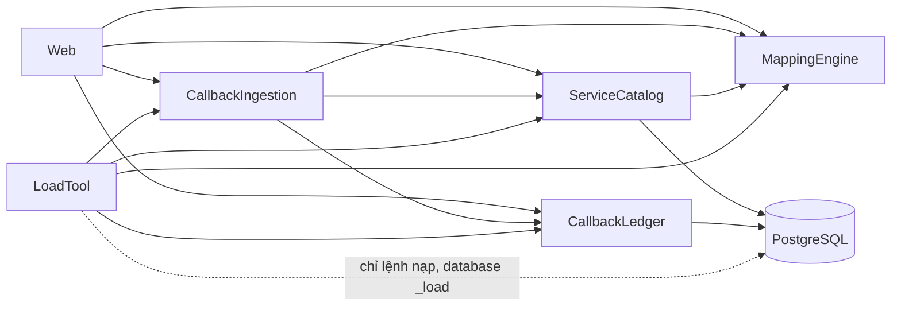

# Thành phần logic: U2 `u2-backend-core`

> Nguồn: `tech-stack-decisions.md` và năm tệp yêu cầu của U2 (NFR Requirements), `functional-spec.md` và `rules.md` của U2, bốn tệp thiết kế cùng cấp trong thư mục này (`performance-design.md`, `security-design.md`, `scalability-design.md`, `reliability-design.md`, `observability-design.md`), `logical-components.md` của U1 và mã U1 trong `tpp-simulator-app/src/main/java`; các quyết định Q4 A và giả định 13, 21 trong `nfr-design-questions.md`. Tài liệu nối quyết định NFR với Infrastructure Design bằng cái nhìn theo thành phần: lớp mới và đổi theo gói, hướng phụ thuộc, vùng lỗi, tài nguyên dùng chung, các thành phần kỹ thuật bao quanh.
>
> **Quy ước mã.** Quyết định đánh số `LC-nn`. Tệp mở rộng `logical-components.md` của U1 (bốn thành phần ServiceCatalog, MappingEngine, CallbackIngestion, CallbackLedger cộng Web và Config, phụ thuộc một chiều, ADR-001, ADR-008) và không mâu thuẫn với nó. Tên lớp là đề xuất bám khung `com.tpp.simulator`; Code Generation có thể đổi tên nhưng giữ ranh giới, hướng phụ thuộc và các quy tắc kiểm thử tĩnh.

## Quan hệ với thiết kế của U1

| Nội dung của U1 | Tình trạng ở U2 |
|---|---|
| Sáu gói `catalog`, `mapping`, `ingestion`, `ledger`, `web`, `config`; phụ thuộc một chiều; `PackageDependencyTest` đọc lệnh `import` | **Giữ**; thêm gói `loadtool`; cập nhật bảng phụ thuộc cho phép (`LC-02`) |
| `ServiceCatalog` phụ thuộc `MappingEngine` chỉ từ U2 | **Bắt đầu hiệu lực ở U2** (kiểm tra mẫu `PATTERN` khi lưu) |
| `CallbackLedger` đọc `services`/`service_config_versions` bằng phép nối SQL chỉ-đọc (phụ thuộc dữ liệu được chấp nhận) | **Giữ**, áp dụng cho cả hai danh sách và chi tiết callback |
| README, `scripts/verify.ps1`, JaCoCo 80%, Spotless, CI, ghim phiên bản (NFR5.1, NFR6.1 đến NFR6.6) | **Giữ nguyên**; U2 chỉ thêm nội dung README, bốn script chạy tay và kiểm thử (`LC-07` đến `LC-13`) |

## Kiểm kê thành phần logic

**`LC-01`: lớp mới và đổi theo gói.** Thỏa `NFR6.22`, `NFR6.23` (phạm vi kiểm thử), `NFR1.28`, `NFR3.29`; ADR-001.

| Gói | Lớp / tài sản | Trạng thái | Trách nhiệm ở U2 | Mẫu NFR (quyết định) |
|---|---|---|---|---|
| `catalog` | `ServiceCatalog` | Đổi | Tạo (kiểm tra đầy đủ), sửa, bật/tắt, xóa mềm, liệt kê, đọc; `findSnapshot` (thay `findRuntime`); khóa dòng `FOR NO KEY UPDATE` | `SC-01`, `RD-01`, `SD-03` (hằng SQL chạm cột khóa: `INSERT_SERVICE`, các `UPDATE_SERVICE_*`, `SELECT_SNAPSHOT`) |
| `catalog` | `ServiceValidator` | Đổi | BR11.1 đến BR11.8, BR12.3; gọi `mapping.TimestampPatterns.validate` | `RD-08` |
| `catalog` | `ServiceConfigComparator` | Mới | So sánh BR12.4: chuẩn hóa từng trường, `responseBody` theo JSON tương đương (số `1` khác `1.0`; khóa trùng so theo văn bản) | `SC-01` |
| `catalog` | `ServiceRuntimeSnapshot` | Mới (thay `ServiceRuntimeConfig`) | Ảnh dịch vụ bất biến của một request: đã xóa, bật/tắt, `authType`, tên header khóa, khóa, phiên bản hiện hành; `toString` che khóa | `SD-03` |
| `catalog` | `ServiceUpdateRequest`, `ServiceEnabledRequest`; `ServiceView` | Mới; đổi | Kiểu yêu cầu sửa và bật/tắt; `apiKeyConfigured` tính bằng `IS NOT NULL` | `SD-03` |
| `mapping` | `MappingEngine`, `MappingConfig` | Đổi | Thêm `timestampFormat`, `timestampPattern` vào cấu hình; bốn định dạng; vẫn thuần, không cơ sở dữ liệu | `RD-08`, `NFR1.28` |
| `mapping` | `TimestampPatterns` | Mới | `compile` (dùng chung) và `validate` (phép thử định dạng) | `RD-08` |
| `mapping` | `UnixTimestampParser` | Mới | Giây và mili giây chính xác, kiểm tra khoảng theo bậc độ lớn trước khi khai triển | `RD-08` |
| `mapping` | `MappingTester`, `SampleJsonDiagnostics` | Mới | Thử mapping thuần (BR18.x); `sampleJsonError` từ từ vựng cố định, không lặp nội dung mẫu | `PD-07`, `SD-09` |
| `ingestion` | `CallbackIngestionService` | Đổi | `receive` (HTTP) và `receiveForLoad` (công cụ nạp) dùng chung `process`; **nơi duy nhất bắt lỗi ghi và lỗi đọc ảnh dịch vụ** (ba khối thử/bắt, `RD-02`); không ném ngoại lệ của kho ra ngoài, luôn trả `IngestionResult` mang `WriteStatus` | `RD-01`, `RD-02`, `LC-03` |
| `ingestion` | `ApiKeyVerifier` | Mới | So khớp khóa API thời gian không đổi (W17) | `SD-02` |
| `ingestion` | `RejectedPayloadClassifier` (gồm kiểm tra miền số) | Mới | Quyết định `payloadJson` hay `payloadRawText` một lần trước khi ghi | `RD-09` |
| `ingestion` | `IngestionResult`, `WriteStatus`, `RejectionReason` | Mới | Kết quả (response cấu hình hoặc từ chối, `recordId`, **`WriteStatus`**, lớp lỗi, SQLSTATE); `WriteStatus` là kiểu liệt kê `WRITTEN`, `ACCEPTED_WRITE_FAILED`, `REJECTED_RECORD_FAILED`, `SNAPSHOT_READ_FAILED` (thay "cờ ghi lỗi"); nhánh `unknownService()` không mang `WriteStatus`; sáu lý do từ chối | `RD-02`, `OD-01` |
| `ledger` | `CallbackLedger` | Đổi | `append` (callback được chấp nhận) giữ nguyên; thêm `appendRejected`, `listTransactions(filter)`, `listCallbacks(filter)`, `findCallback(recordId)` | `PD-02`, `PD-04`, `RD-01` |
| `ledger` | `ListQueryBuilder`, `TransactionFilter`, `CallbackFilter`, `TimeBounds` | Mới | Ghép đoạn SQL cố định; ngữ nghĩa thời gian; kẹp cận; **thay hằng `CallbackLedger.LIST_TRANSACTIONS` của U1** (bộ dựng không bộ lọc sinh đúng câu cũ, `QueryPlanTest` của U1 chuyển sang gọi bộ dựng, `PD-11`) | `PD-02`, `PD-05`, `PD-11`, `SD-06` |
| `ledger` | `CallbackListItem`, `CallbackDetail` | Mới; đổi | Dòng danh sách và chi tiết một lần nhận (BR19.5, BR19.6) | `PD-06` |
| `web` | `CallbackController`, `CallbackAccessLog`, `CallbackLogEntry` | Đổi; mới | **Chỉ ánh xạ `IngestionResult` (theo `WriteStatus`) sang response HTTP, không bắt lỗi ghi của riêng nó**; ghi đúng một dòng nhật ký; gắn header `X-Simulator-Record-Failed` khi `REJECTED_RECORD_FAILED` | `OD-01`, `OD-02`, `RD-02` |
| `web` | `RequestSizeLimitFilter` | Đổi | Bảng chính sách theo đường dẫn: `/callbacks/**` trần 1.048.576 byte → `413`; `POST /api/mapping-tests` trần 8 MiB → `400` | `PD-07` |
| `web` | `ServiceController` | Đổi | `GET` danh sách, `PUT` sửa, `PUT .../enabled`, `DELETE` | `SC-01` |
| `web` | `MappingTestController` | Mới | `POST /api/mapping-tests`; không `@Transactional`, không bean dữ liệu | `PD-07` |
| `web` | `TransactionController`, `CallbackQueryController`, `ListParams` | Đổi; mới; mới | Danh sách có lọc, danh sách callback, chi tiết một lần nhận; đọc và kiểm tra tham số (BR19.3) | `PD-02`, `PD-05` |
| `web` | `ApiErrors`, `ApiExceptionAdvice` | Đổi nhỏ | Header phụ; mã `CALLBACK_NOT_FOUND`; không ghi dòng thứ hai cho endpoint callback | `OD-01`, `RD-02` |
| `config` | `MaskedHeaders`, `ErrorCode` | Đổi | Che thêm header khóa của dịch vụ; thêm mã lỗi còn thiếu (`UNAUTHORIZED`, `CALLBACK_NOT_FOUND`) | `SD-01` |
| `loadtool` | `LoadToolMain`, `LoadCommand`, `LoadBootstrap`, `LoadToolContext`, `LoadParameters`, `DatabaseNameGuard`, `LoadRunner`, `LoadDataGenerator`, `LoadServiceDefinitions`, `LoadReport`, `LoadRefusedException` | Mới (gói mới) | Công cụ nạp (xem `LC-04`) | `PD-08`, `SD-07`, `RD-07`, `OD-05` |
| Lược đồ | `V2__list_filter_indexes.sql` | Mới | Bốn chỉ mục btree | `PD-03`, `RD-06` |
| Tài sản | `docs/samples/*`, `scripts/*.ps1`, `scripts/create-sample-services.sh`, README | Mới; đổi | Dịch vụ mẫu, bốn script chạy tay, hướng dẫn | `SC-05` đến `SC-07`, `LC-07`, `LC-13` |
| Kiểm thử hỗ trợ | `FailureTrigger`, `LogCapture`, quét dọn ở `AbstractIntegrationTest`, bộ gửi song song | Mới; đổi | Hạ tầng kiểm thử (chỉ trong `src/test`) | `RD-04`, `OD-02`, `SD-10` |

## Phụ thuộc gói

**`LC-02`: phụ thuộc một chiều, thêm `loadtool`, không gói nào phụ thuộc `loadtool`.** Thỏa `NFR6.22`, `NFR3.26`; ADR-001.

`PackageDependencyTest` của U1 có bảng cho phép; U2 cập nhật như sau (phần in đậm là thay đổi):

| Gói | Được phụ thuộc |
|---|---|
| `web` | `ingestion`, `catalog`, `ledger`, `config`, **`mapping`** (cho `MappingTestController`) |
| `ingestion` | `catalog`, `mapping`, `ledger`, `config` |
| `catalog` | `config`, **`mapping`** (kiểm tra mẫu khi lưu) |
| `mapping` | không gói nào |
| `ledger` | `config` |
| `config` | không gói nào |
| **`loadtool`** (gói mới) | `ingestion`, `catalog`, `ledger`, `mapping`, `config` |



Kiểm thử tĩnh mới hoặc mở rộng (đọc lệnh `import` và tên, không thêm thư viện):

1. **Bảng cho phép** như trên; `theDependencyGraphHasNoCycles` giữ nguyên.
2. **Không gì dùng `loadtool`:** trong `src/main`, không tệp nào ngoài gói `loadtool`, kể cả `TppSimulatorApplication.java` và `application.yml`, chứa `com.tpp.simulator.loadtool`. Mã kiểm thử trong `src/test` (ví dụ `LoadRunnerSmallRunTest`) được phép dùng gói này.
3. **Mã công cụ nạp không có chú thích Spring:** các tệp trong `loadtool` không chứa `@Component`, `@Service`, `@Repository`, `@Configuration`, `@Controller`, `@RestController`, `@SpringBootApplication`, `@EnableAutoConfiguration`. Vì `TppSimulatorApplication` quét toàn bộ `com.tpp.simulator`, đây là cách bảo đảm ứng dụng chính không đăng ký bất kỳ bean nào của công cụ nạp và không có đường nào gọi nó (BR22.1, "không chạy lúc khởi động").
4. **`receiveForLoad` chỉ xuất hiện trong `ingestion` và `loadtool`:** `web` không gọi lối vào đặt `receivedAt` (`LC-03`).
5. **`MappingTestController` không có tham số hay trường kiểu** `JdbcClient`, `DataSource`, `CallbackLedger`, `ServiceCatalog`, `PlatformTransactionManager` (`PD-07`).
6. **`MappingEngine` thuần** (kiểm thử của U1): không `java.sql`, `org.springframework.jdbc`, `org.springframework.web`, `jakarta.servlet`; áp dụng cho cả `TimestampPatterns` và `UnixTimestampParser` vì cùng gói `mapping`.
7. **Chỉ `CallbackIngestionService` bắt lỗi ghi (`RD-02`):** `CallbackController` không chứa `catch` cho `DataAccessException`, `TransactionException`, `SQLException` và không có trường hay tham số kiểu `CallbackLedger`, `JdbcClient`, `DataSource`; `LoadRunner` không `catch` ngoại lệ truy cập dữ liệu quanh lệnh gọi `receiveForLoad` (nó đọc `WriteStatus`).

**`LC-03`: lối vào nội bộ của logic nhận callback cho công cụ nạp.** Thỏa BR22.1; `NFR1.26`.

`CallbackIngestionService` có hai lối vào công khai dùng chung một phần xử lý `process(snapshot, contentType, rawHeaders, body, receivedAt)` (từ kiểm tra "đã xóa" tới ghi và dựng response, W16 bước 5 đến 12 và W18):

- `receive(serviceCode, contentType, rawHeaders, body, receivedAt)`: lối vào HTTP. Đọc ảnh dịch vụ (khối (A) của `RD-02`; lỗi đọc → `IngestionResult` có `WriteStatus = SNAPSHOT_READ_FAILED`, không ném), trả nhánh `unknownService()` nếu không có dịch vụ, rồi gọi `process`. `receivedAt` do `RequestSizeLimitFilter` gán lúc bắt đầu nhận; không có tham số HTTP hay API nào cho người gọi đặt nó.
- `receiveForLoad(snapshot, contentType, rawHeaders, body, receivedAt)`: **chỉ công cụ nạp dùng.** Nhận sẵn ảnh dịch vụ và `receivedAt` do công cụ chọn, gọi thẳng `process`. Nhờ nhận ảnh dịch vụ từ ngoài, công cụ tạo lý do `SERVICE_DISABLED` và `SERVICE_DELETED` bằng cách đưa vào một biến thể ảnh ở trạng thái đó (BR22.4) mà bản ghi dịch vụ trong database đích vẫn bật; và không phải đọc dịch vụ trong vòng lặp (`PD-08`).

**Nơi duy nhất bắt lỗi ghi (`RD-02`).** `process` chứa các khối (B) và (C); `receive` chứa thêm khối (A). Các khối bắt mọi ngoại lệ của kho và **trả `IngestionResult` với `WriteStatus` tường minh** thay vì ném: `WRITTEN` (bản ghi đã commit), `ACCEPTED_WRITE_FAILED` (khối B), `REJECTED_RECORD_FAILED` (khối C; kết quả vẫn mang mã từ chối gốc), `SNAPSHOT_READ_FAILED` (khối A, chỉ ở `receive`). Không lớp nào khác (controller, `LoadRunner`) bắt lỗi ghi: controller chỉ ánh xạ kết quả sang HTTP (`500` cho B và A, mã gốc kèm `X-Simulator-Record-Failed` cho C); `LoadRunner` coi **mọi** `WriteStatus` khác `WRITTEN` là lỗi đầu tiên (dừng ngay, không nạp tiếp, mã thoát `1`, báo số bằng `COUNT(*)`, BR22.5, `NFR2.27`, `RD-07`).

Hai lối vào chạm cùng quy tắc ánh xạ, che header, gom giao dịch, ghi lần từ chối của ứng dụng và cùng đường bắt lỗi ghi, nên dữ liệu nạp tuân quy tắc nghiệp vụ (BR22.1) và lỗi ghi của công cụ nạp đi đúng đường mà HTTP đi. Quy tắc ở mục 4 của `LC-02` ngăn lối vào thứ hai xuất hiện trong `web`; mục 7 của `LC-02` ngăn controller bắt lỗi ghi.

## Công cụ nạp

**`LC-04`: cấu trúc, ngữ cảnh Spring tối thiểu, cách chạy (Q4 A).** Thỏa `NFR3.25`, `NFR3.26`, `NFR6.21`, `NFR6.22`; BR22.1 đến BR22.5.

| Lớp | Việc | Ghi chú |
|---|---|---|
| `LoadToolMain` | Có `main` riêng: `System.exit(new LoadCommand(...).run(args))` | Một dòng; không logic, để không kéo tụt bao phủ |
| `LoadCommand` | Trình tự khởi chạy của `SD-07`: tham số → kiểm tra tên → kết nối ngắn/tạo database → khởi động ngữ cảnh → kiểm tra `current_database()` → nạp; trả mã thoát `0/1/2` | Nhận "bộ mở kết nối", biến môi trường và `PrintStream` qua hàm tạo để kiểm thử, kể cả khẳng định lệnh bị từ chối không mở kết nối nào |
| `LoadBootstrap` | Dựng `SpringApplicationBuilder(LoadToolContext.class)` với `WebApplicationType.NONE` | Phần ngắn, không phủ được bằng kiểm thử thường (cần database `_load`); giữ nhỏ vì lý do bao phủ |
| `LoadToolContext` | Lớp **không** có `@Configuration`/`@Component`; chỉ `@Import` các bean cần (`ServiceCatalog`, `ServiceValidator`, `MappingEngine`, `CallbackIngestionService`, `CallbackLedger`, `ClockConfig`, `JacksonConfig`) và `@ImportAutoConfiguration` nguồn dữ liệu, giao dịch, `JdbcClient`, Flyway, Jackson | Không nạp gói `web` (không controller, bộ lọc, bộ xử lý lỗi); danh sách cấu hình tự động chốt ở Code Generation theo bản Spring Boot 3.5.16 |
| `LoadParameters` | `--callbacks`, `--seed`, `--days`, `--services`, `--append`, `--database` | Tự phân tích `--tên=giá trị` (không thư viện đọc tham số, `NFR6.21`); tham số lạ hay sai kiểu → từ chối (mã thoát 2) |
| `DatabaseNameGuard` | Hàm thuần kiểm tra tên `_load` | `SD-07` |
| `LoadRunner` | Lõi nạp: `validateTarget` (tham số và tên database, dùng `DatabaseNameGuard`) và `run` (sinh dữ liệu và ghi) | `run` **không** kiểm tra tên và không tự kết nối hay tạo database; kiểm thử nạp quy mô nhỏ gọi `run` trực tiếp trên `tpp_simulator_test` (ngoại lệ có kiểm soát của `NFR3.26`). Với mỗi lần nhận gọi `receiveForLoad` rồi đọc `WriteStatus`: **mọi giá trị khác `WRITTEN` là lỗi đầu tiên, dừng ngay, không nạp tiếp, mã thoát `1`, báo số bằng `COUNT(*)`** (`RD-07`, `LC-03`); `run` trả kết quả mang mã thoát để kiểm thử khẳng định |
| `LoadDataGenerator`, `LoadServiceDefinitions` | Sinh tất định bằng `SplittableRandom(seed)`; cấu hình dịch vụ `LOAD_xx` theo **bảng gán cố định theo số thứ tự** (`NONE`/`API_KEY`, `ISO_8601`/`PATTERN`/`UNIX_MILLIS`, lặp lại), biến thể ảnh `SERVICE_DISABLED`/`SERVICE_DELETED`/`API_KEY` | `PD-08` |
| `LoadReport` | Tiến độ, tổng kết, lỗi | `OD-05` |

- **Ngữ cảnh Spring được cấu hình bằng nguồn thuộc tính ưu tiên cao nhất** (bộ khởi tạo ngữ cảnh thêm `MapPropertySource` vào đầu danh sách nguồn): `spring.datasource.url` (URL đích), `spring.datasource.hikari.maximum-pool-size=2`, `spring.main.banner-mode=off`, mức nhật ký `WARN`. Không dùng `SpringApplicationBuilder.properties(...)` vì đó là nguồn ưu tiên thấp nhất và `application.yml` sẽ thắng.
- **Cách chạy, một lệnh trong README, không script bọc, không phụ thuộc hay plugin mới:**

```powershell
$env:SPRING_DATASOURCE_URL = "jdbc:postgresql://localhost:5432/tpp_simulator"   # database của ứng dụng
$env:SPRING_DATASOURCE_USERNAME = "tpp"; $env:SPRING_DATASOURCE_PASSWORD = "<mật khẩu>"
java -Dloader.main=com.tpp.simulator.loadtool.LoadToolMain -cp target\tpp-simulator-app-0.0.1-SNAPSHOT.jar `
  org.springframework.boot.loader.launch.PropertiesLauncher --callbacks=100000 --database=tpp_simulator_load
```

  `PropertiesLauncher` là một phần của tệp JAR đóng gói bởi `spring-boot-maven-plugin` sẵn có; `loader.main` chọn lớp `main` khác `Main-Class` của ứng dụng. Ứng dụng chính không có đường nào gọi `LoadToolMain` (kiểm thử tĩnh ở `LC-02`).
- **Kiểm thử ngữ cảnh** (không đi qua `LoadCommand`): một kiểm thử dựng `SpringApplicationBuilder(LoadToolContext.class).web(NONE)` trỏ vào `tpp_simulator_test` (chỉ để Flyway không làm gì và nạp bean; không ghi), khẳng định ngữ cảnh có đủ bean cần cho `LoadRunner`, không có bean `@RestController` nào và không phải `ServletWebServerApplicationContext`.

## Vùng lỗi và phạm vi ảnh hưởng

**`LC-05`: bổ sung cho bảng của U1.** Thỏa `NFR2.24`, `NFR2.26`, `NFR2.27`, `NFR3.26`.

| Sự cố | Ảnh hưởng | Cách chứa |
|---|---|---|
| PostgreSQL không dùng được | Callback `500` (không header) hoặc lần nhận bị từ chối trả mã gốc kèm `X-Simulator-Record-Failed`; API quản lý `500`; thử mapping vẫn `200`; `/actuator/health` `DOWN` | Pool chờ 5 giây; tự phục hồi trong 30 giây (`RD-02`, `RD-03`) |
| Lỗi ghi lần nhận bị từ chối | Chỉ lần nhận đó không được lưu; response gốc vẫn tới người gọi | Giao dịch riêng, một lần thử, header báo (`RD-02`) |
| Lỗi ghi giữa chừng một lần sửa dịch vụ | Chỉ lần sửa đó; dịch vụ giữ nguyên | Một giao dịch (`RD-01`) |
| Tranh chấp khóa trên cùng một dịch vụ | Các thao tác **sửa/bật-tắt/xóa của cùng dịch vụ** xếp hàng ở **khóa dòng** (tối đa 5 giây mỗi lần chờ). Nhận callback và thao tác dịch vụ khác **không chờ khóa dòng đó**, nhưng **mỗi thao tác đang xếp hàng giữ một kết nối pool** trong lúc chờ (1 đang chạy, các thao tác còn lại đang chờ khóa), nên khi từ khoảng 10 thao tác của cùng một dịch vụ đang xếp hàng thì pool cạn và callback hay API của dịch vụ khác **có thể chờ ở pool** (tối đa 5 giây, rồi `500`) | `FOR NO KEY UPDATE`, `lock_timeout` (`SC-01`); đói pool là hệ quả đã biết, không phải lỗi khóa: `SC-01` "Đói pool" nêu cách xử lý và ranh giới kiểm thử `NFR2.24` |
| Bộ lọc danh sách giá trị lạ, trang rất sâu | Chỉ request đó; không `500` do tràn số hay ngoài khoảng thời gian | Kẹp cận, cắt trang rỗng (`PD-04`, `PD-05`) |
| Thử mapping với mẫu lớn | Chỉ request đó; không chạm cơ sở dữ liệu | Trần 8 MiB, `1.048.576` byte cho mẫu (`PD-07`) |
| Công cụ nạp lỗi hay bị dừng | Tiến trình riêng, database `_load` riêng; backend đang chạy không bị ảnh hưởng ngoài tải ghi/đĩa của cùng máy chủ PostgreSQL | Mã thoát khác 0, dữ liệu đã commit giữ nguyên (`RD-07`) |
| Script chạy tay lỗi | Chỉ phía máy khách; `check-concurrency.ps1` có thể để lại dịch vụ tạm đã xóa mềm cùng 100 Callback | README nêu cách dọn bằng xóa database (`SC-05`, `SC-08`) |

Một tiến trình backend và một cơ sở dữ liệu vẫn là vùng lỗi lớn nhất; công cụ nạp là tiến trình thứ hai nhưng chỉ ghi vào database `_load`, nên không làm hỏng dữ liệu thật.

**`LC-06`: tài nguyên dùng chung, bổ sung cho bảng của U1.**

| Tài nguyên | Người dùng | Giới hạn |
|---|---|---|
| Pool kết nối của backend (10) | Nhận callback, API quản lý, tra cứu | Chờ tối đa 5 giây; giao dịch sửa chỉ dùng **một** kết nối (`SC-01`). Một thao tác sửa/bật-tắt/xóa đang **chờ khóa dòng vẫn giữ kết nối đó**: từ khoảng 10 thao tác cùng dịch vụ xếp hàng thì cả pool bị chiếm và mọi request khác (kể cả callback) chờ ở pool, không ở khóa (`SC-01` "Đói pool") |
| Pool kết nối của công cụ nạp (2) | Công cụ nạp, Flyway lúc khởi động | Tiến trình và pool riêng, không tranh pool của backend |
| Khóa dòng `services` | Sửa, bật/tắt, xóa mềm cùng dịch vụ | `lock_timeout` 5 giây; **không chặn callback ở mức khóa dòng** (kiểm tra khóa ngoại `FOR KEY SHARE` không xung đột với `FOR NO KEY UPDATE`); callback chỉ có thể bị chậm gián tiếp qua pool khi nhiều thao tác sửa đang xếp hàng (dòng "Pool kết nối" ở trên) |
| Máy chủ PostgreSQL và đĩa | Backend và công cụ nạp (hai database khác nhau trên cùng máy chủ) | Không nên chạy công cụ nạp lúc đang đo `NFR1.21`/`NFR1.24`; README ghi điều này |
| Logger `CallbackAccessLog` | Mọi request callback | Một dòng mỗi request (`OD-01`) |
| Đồng hồ (`Clock`) | `receivedAt` của endpoint thật; kiểm thử thay được | Công cụ nạp chọn `receivedAt` riêng qua `receiveForLoad` (`LC-03`) |

## Thành phần kỹ thuật bao quanh: README, xây dựng, kiểm thử, CI

**`LC-07`: README của `tpp-simulator-app` có bảy mục (NFR5.25).** Thỏa `NFR5.25`.

1. Chạy script tạo ba dịch vụ mẫu (PowerShell và bash) và các lệnh cURL mẫu (`docs/samples`).
2. Chạy công cụ nạp: lệnh ở `LC-04`, các tham số, quy ước tên database `_load` và mặc định `tpp_simulator_load`, cách tạo database thủ công khi công cụ không tạo được (câu lệnh công cụ in ra), cách xóa database nạp.
3. Chạy `scripts/measure-list-latency.ps1` (đường dẫn tính từ gốc kho), kèm lời nêu rõ chỉ **một** kịch bản được đo và những gì **không** được đo (`PD-10`).
4. Chạy `scripts/check-concurrency.ps1`, tiêu chí đạt gồm `maxInFlight >= 25` và ý nghĩa của INCONCLUSIVE (`SC-05`).
5. Cảnh báo đĩa đầy và cách dọn bằng xóa database (`SC-08`); chạy công cụ nạp không đồng thời với phép đo.
6. Nếu `pg_trgm` được thêm thì điều kiện môi trường mới (`LC-12`); mặc định không cần.
7. Điều kiện cần: Windows PowerShell 5.1, `curl.exe`; quyền `CREATEDB` chỉ cần để lệnh nạp thật tự tạo database `_load`, **không** cần cho `scripts\verify.ps1`. Cộng ghi chú chẩn đoán dòng nhật ký (`OD-02`) và giới hạn payload không lưu được ở dạng `jsonb` (BR14.8).

Tất cả script README nhắc nằm trong `tpp-simulator-app\scripts\` và README tham chiếu bằng đường dẫn tương đối `scripts/<tên>`. Build and Test làm theo README và mỗi lệnh chạy đúng như mô tả.

**`LC-08`: không cần Docker cho bất kỳ bước kiểm chứng nào (NFR5.26).** Thỏa `NFR5.26`. Kiểm thử tự động chạy trên PostgreSQL cài sẵn qua `TPP_TEST_DB_URL`, `TPP_TEST_DB_USER`, `TPP_TEST_DB_PASSWORD` (database có tên chứa `test`), Testcontainers chỉ khi thiếu các biến đó (CI GitHub Actions); công cụ nạp và hai script đo dùng PostgreSQL cài sẵn; lệnh dọn dẹp ở README dùng `DROP DATABASE`/`CREATE DATABASE` trước, Docker sau. Báo cáo Build and Test liệt kê các lệnh đã chạy và không có lệnh `docker`.

**`LC-09`: `pom.xml` không đổi (NFR6.21).** Thỏa `NFR6.21`. Không thêm `<dependency>` hay `<plugin>`; phiên bản đã ghim giữ nguyên. Mọi thứ U2 cần có sẵn: `JdbcClient`, Flyway, Jackson (đọc luồng, `BigDecimal`), `java.time`, `java.net.http` (kiểm thử), `ListAppender` của logback-core, `PropertiesLauncher` trong JAR đóng gói. Kiểm tra khi duyệt: `git diff` của `pom.xml` so với bản trước U2 rỗng. Nếu Code Generation thấy buộc phải thêm, phải quay lại ghi quyết định vào `tech-stack-decisions.md` và hỏi người dùng.

**`LC-10`: kiểm thử và bao phủ của U2 (NFR6.22).** Thỏa `NFR6.22`.

- Công cụ nạp được kiểm thử bằng một lần chạy quy mô nhỏ trong bộ kiểm thử thường (500 callback, hai dịch vụ `LOAD_01` `NONE` + `ISO_8601` và `LOAD_02` `API_KEY` + `PATTERN` theo bảng gán của `PD-08`, nên **có dịch vụ `API_KEY`** và đủ sáu lý do từ chối khi có ít nhất sáu lần bị từ chối trong 500 lần nhận): gọi **trực tiếp `LoadRunner.run`** trên `tpp_simulator_test` với dịch vụ `LOAD_` được dọn trước và sau, nên không cần database `_load` hay quyền `CREATEDB`. Kiểm tra tên `_load` được kiểm thử riêng bằng kiểm thử đơn vị `DatabaseNameGuard` và kiểm thử `LoadCommand`.
- Mã công cụ nạp **tính** vào ngưỡng 80% line coverage; JaCoCo giữ cấu hình hiện tại (chỉ loại `TppSimulatorApplication.class`), không thêm loại trừ. Các phần của `LoadCommand` đòi database `_load` thật được tách vào `LoadBootstrap` nhỏ (`LC-04`) để lượng dòng không phủ được là nhỏ so với toàn bundle.
- Phép đo `NFR1.21` và script `NFR2.21` **không** nằm trong bộ kiểm thử thường, `scripts/verify.ps1` hay CI. `scripts/verify.ps1` ở gốc workspace giữ nguyên và không gọi bốn script mới.

**`LC-11`: danh mục kiểm thử tích hợp của U2 (NFR6.23).** Thỏa `NFR6.23`. Tên lớp là đề xuất; trọng tâm theo team (mapping, timestamp, xác thực, lịch sử, đồng thời, API tích hợp), không kiểm thử lặp getter/setter.

| Nhóm | Lớp kiểm thử | NFR / quy tắc |
|---|---|---|
| Thứ tự kiểm tra, mã lỗi | `CallbackOrderingTest` | BR14.2, BR14.3, BR14.6 |
| Xác thực khóa API (W17) | `ApiKeyAuthTest`, `ApiKeyVerifierTest` | `NFR3.23` |
| Ghi lần nhận bị từ chối, hình thức payload, che header | `RejectedReceiptTest`, `RejectedPayloadClassifierTest` | `NFR3.22`, BR15.x, `RD-09` |
| Lỗi ghi và header `X-Simulator-Record-Failed` | `RejectionWriteFailureTest` | `NFR2.26` |
| Bốn định dạng timestamp | `TimestampPatternsTest`, `UnixTimestampParserTest`, `MappingEngineTest` (mở rộng) | BR17.x, `RD-08` |
| Bộ lọc, phân trang, thứ tự | `ListFilterTest`, `ListPagingTest` | BR19.x |
| Chống tiêm qua bộ lọc | `ListInjectionTest` | `NFR3.27` |
| `EXPLAIN` không quét tuần tự | `ListQueryPlanTest` (lớp **độc lập**, không kế thừa `QueryPlanTest` của U1; `PD-11`); `QueryPlanTest` của U1 chỉ đổi dòng lấy SQL danh sách giao dịch sang bộ dựng, giữ nguyên ba khẳng định | `NFR1.23` |
| Sửa dịch vụ và phiên bản | `ServiceEditTest`, `ServiceEditConcurrencyTest` (ca chính tách khóa ngoại khỏi đói pool, ca phụ về đói pool; `SC-01`), `ServiceEditAtomicityTest` | BR12.x, `NFR2.24`, `NFR2.30` |
| Thử mapping | `MappingTestApiTest` | BR18.x, `NFR1.28` |
| Ba dịch vụ mẫu, khởi động không tự tạo | `SampleServicesTest`, `StartupDoesNotSeedTest` | `NFR7.21`, `NFR7.22` |
| Quét không lộ khóa | `SecretLeakScanTest` | `NFR3.21`, `NFR3.22` |
| Nhật ký | `CallbackLoggingTest`, `DatabaseDownLoggingTest` | `NFR5.21`, `NFR5.22`, `NFR3.24` |
| Công cụ nạp | `DatabaseNameGuardTest`, `LoadCommandTest`, `LoadRunnerSmallRunTest`, `LoadRunnerWriteFailureTest` (ép lỗi qua `CallbackIngestionService` thật, hai ca chấp nhận và từ chối), `LoadRunnerStopsOnFirstFailureTest`, `LoadReportTest`, `LoadToolContextTest` | `NFR3.25`, `NFR3.26`, `NFR2.27`, `NFR2.29`, `NFR5.24`, `NFR1.27` |
| Trạng thái ghi của lối vào dùng chung | `IngestionWriteStatusTest` (gọi `receive` và `receiveForLoad` của `CallbackIngestionService` thật với `FailureTrigger` và pool hỏng) | `NFR2.26`, `NFR2.27`, `RD-02` |
| Quy tắc tĩnh | `ApiKeyColumnRulesTest`, `SourceRulesTest` (mở rộng), `PackageDependencyTest` (mở rộng), `ScriptsTest` | `NFR3.29`, `NFR2.28`, `NFR6.24`, `LC-02` |
| Giữ nguyên của U1 | `TransactionConcurrencyTest`, `ReliabilityTest`, `SchemaMigrationTest`, `ConfigurationTest`, `QueryPlanTest` (chỉ đổi nguồn SQL danh sách giao dịch, `PD-11`)... | `NFR2.23` |

Danh mục được đối chiếu với `traceability.json` của Functional Design (AC1.x.x) và của stage này (mã `NFRx.y`) khi duyệt Unit.

**`LC-12`: chính sách bản chuyển và `pg_trgm` (NFR6.24).** Thỏa `NFR6.24`. `V1__init_schema` không bao giờ sửa (SHA-256 cố định trong kiểm thử, `RD-06`); mọi thay đổi lược đồ của U2 nằm ở `V2` trở đi; hiện chỉ có `V2` với bốn `CREATE INDEX`. **Không có `CREATE EXTENSION`** trong bất kỳ bản chuyển nào trừ khi một phép đo cho thấy bộ lọc chuỗi chứa không đạt p95 dưới 1000 ms; khi đó thêm `pg_trgm` và chỉ mục ở `V3` trở đi và cập nhật `tech-stack-decisions.md` cùng README (mục 6 của `LC-07`). Khi duyệt Unit: tìm `CREATE EXTENSION` trong thư mục bản chuyển không có kết quả (hoặc có kèm cập nhật), `V1` không đổi.

**`LC-13`: kiểm kê script (đều trong `tpp-simulator-app/scripts/`).** Thỏa `NFR1.21`, `NFR2.21`, `NFR7.22`.

| Script | Dùng cho | Mã thoát | Quyết định |
|---|---|---|---|
| `measure-list-latency.ps1` | `NFR1.21` | `0` đạt; `1` p95 từ 1000 ms trở lên, có phản hồi không `200`, hay không kết nối | `PD-09` |
| `check-concurrency.ps1` | `NFR2.21`, `NFR2.22` | `0` cả hai PASS; `1` có FAIL; `2` INCONCLUSIVE | `SC-05` |
| `create-sample-services.ps1` | `NFR7.22` | `0` mọi dịch vụ đã tạo hoặc đã tồn tại; `1` có lỗi khác | `SC-07` |
| `create-sample-services.sh` | `NFR7.22` | như trên | `SC-07` |

Quy ước chung: PowerShell tương thích Windows PowerShell 5.1 (không `??`, `?.`, `-Parallel`, toán tử ba ngôi), lưu UTF-8 có BOM; bash kết thúc dòng LF; chỉ gọi API HTTP của backend đang chạy qua `-BaseUrl` (mặc định `http://127.0.0.1:8080`) và không gọi công cụ nạp; `ScriptsTest` kiểm BOM, cú pháp bị cấm và LF. `D:\pet-pj-dlc\scripts\verify.ps1` ở gốc workspace giữ nguyên chỗ và không gọi bốn script này.

## Sources

- `aidlc/spaces/default/intents/261018-tpp-callback-simulator/construction/u2-backend-core/nfr-requirements/tech-stack-decisions.md` (tech-stack-decisions: NFR5.25, NFR5.26, NFR6.21 đến NFR6.24), `performance-requirements.md` (performance-requirements), `security-requirements.md` (security-requirements), `scalability-requirements.md` (scalability-requirements), `reliability-requirements.md` (reliability-requirements) và `observability-requirements.md` (observability-requirements)
- `aidlc/spaces/default/intents/261018-tpp-callback-simulator/construction/u2-backend-core/functional-design/functional-spec.md` (functional-spec: W11 đến W25, mục 5 thay đổi hợp đồng) và `rules.md` (rules: BR11.x đến BR22.x)
- `aidlc/spaces/default/intents/261018-tpp-callback-simulator/construction/u2-backend-core/nfr-design/performance-design.md`, `security-design.md`, `scalability-design.md`, `reliability-design.md`, `observability-design.md` (quyết định `PD-nn`, `SD-nn`, `SC-nn`, `RD-nn`, `OD-nn`)
- `aidlc/spaces/default/intents/261018-tpp-callback-simulator/construction/u2-backend-core/nfr-design/nfr-design-questions.md` (Q4 A, giả định 13, 21)
- `aidlc/spaces/default/intents/261018-tpp-callback-simulator/construction/u1-backend-skeleton/nfr-design/logical-components.md` (kiểm kê U1, phụ thuộc gói, vùng lỗi)
- `tpp-simulator-app/pom.xml`, `tpp-simulator-app/src/main/java/com/tpp/simulator/**`, `tpp-simulator-app/src/test/java/com/tpp/simulator/PackageDependencyTest.java`, `.../SourceRulesTest.java` (mã U1, chỉ đọc)

## Assumptions & Open Questions

- **Danh sách `@Import`/`@ImportAutoConfiguration` của `LoadToolContext` chưa chạy thử** (không được sửa mã ở stage này): kiểm thử `LoadToolContextTest` ở Code Generation là bằng chứng; nếu cần thêm một bean thì thêm vào danh sách mà không đổi ranh giới (vẫn không có gói `web`, không có chú thích Spring ở `loadtool`).
- **Cách tách `LoadRunner` (có `validateTarget` và `run`)** diễn giải câu "lõi gồm kiểm tra tham số và tên database, sinh dữ liệu, ghi" của Q4 A cùng ngoại lệ của `NFR3.26` (kiểm thử gọi lõi mà không qua kiểm tra tên): `run` không kiểm tra tên, `LoadCommand` luôn gọi `validateTarget` trước. Đây là chỗ hai câu có thể bị đọc lệch nhau; thiết kế chọn cách thỏa cả hai.
- **Bảng phụ thuộc gói** (`web` → `mapping`, `catalog` → `mapping`) đổi bảng cho phép của kiểm thử U1: cả hai thay đổi đã được U1 báo trước (`catalog` → `mapping` từ U2) hoặc là hệ quả của `MappingTestController`; nếu bạn muốn `web` không phụ thuộc `mapping`, cho thử mapping đi qua một lớp mỏng ở `catalog` hoặc `ingestion`.
- **Tên gói/lớp** là đề xuất; **số lần chạy** các script do Build and Test quyết định và ghi vào báo cáo.
- Không có câu hỏi mở nào khác.
