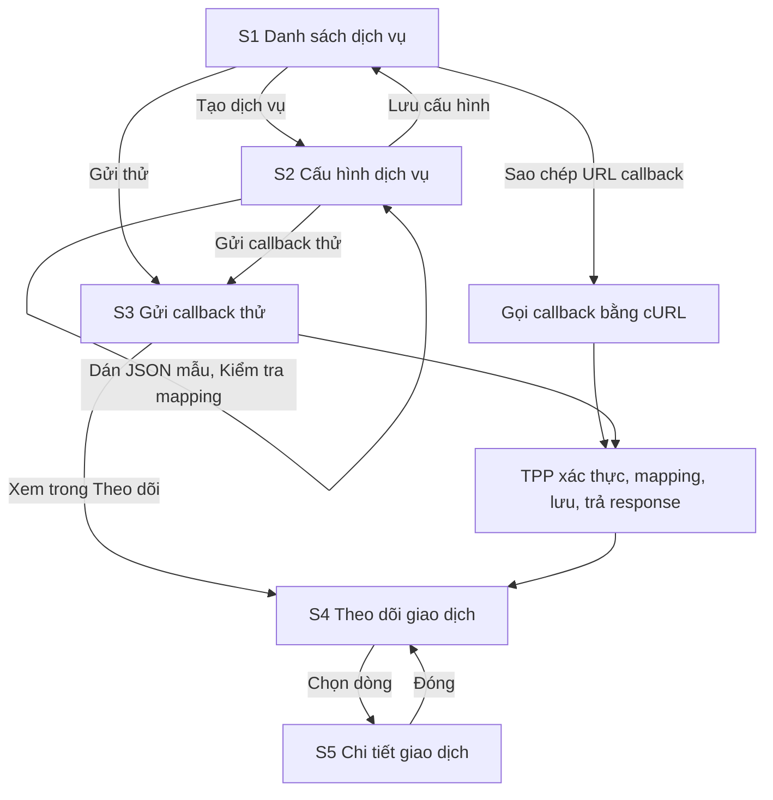

# User Flow — TPP Callback Simulator (MVP)

Các màn hình S1–S5 được mô tả trong `wireframes.md`.

## Luồng chính (happy path)

Dạng chữ:

1. Người kiểm thử mở danh sách dịch vụ (S1) và bấm "Tạo dịch vụ".
2. Ở trang cấu hình (S2), nhập mã, tên, xác thực, mapping và response; dán JSON mẫu để kiểm tra mapping, việc này không lưu dữ liệu; rồi lưu cấu hình.
3. Sao chép URL callback để gọi bằng cURL, hoặc mở trang gửi callback thử (S3) từ danh sách hay từ trang cấu hình.
4. TPP xác thực, mapping, lưu lần nhận và trả response đã cấu hình.
5. Mở "Theo dõi giao dịch" (S4), lọc theo dịch vụ, transactionId, status hoặc thời gian nhận.
6. Chọn một giao dịch để mở chi tiết (S5) ở bảng trượt bên phải; đóng thì quay về đúng danh sách, bộ lọc và trang cũ.

## Luồng phụ

| Luồng | Các bước | Căn cứ |
|---|---|---|
| Sửa dịch vụ | S1 → "Sửa" → S2 (mã dịch vụ bị khóa) → Lưu; cấu hình mới chỉ áp dụng cho callback mới | brief mục 3, 6 |
| Bật/tắt dịch vụ | S1 bấm công tắc, hoặc S2 công tắc "Bật"; dịch vụ tắt thì callback trả 503 | brief mục 3, 6 |
| Xóa dịch vụ | S1 → "Xóa" → hộp thoại xác nhận (S1a) → dịch vụ biến khỏi danh sách; URL trả 404; lịch sử vẫn xem được ở S4 | intent statement, [Q6] |
| Xem callback lỗi | S4 → tab "Tất cả callback" → lọc kết quả mapping "Lỗi"; callback thiếu transactionId chỉ có ở tab này, không nhóm vào giao dịch | brief mục 5, 6, [Q6] |
| Tự cập nhật | S4 bật/tắt tự cập nhật 5 giây hoặc bấm "Tải lại"; bộ lọc, trang và chi tiết đang mở được giữ nguyên | brief mục 5, [Q4] |

## Assumptions & Open Questions

None.
