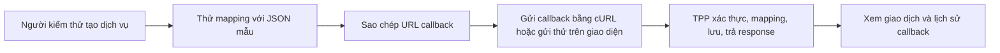

# Scope Document — TPP Callback Simulator (MVP)

## Mục tiêu phạm vi

MVP giúp người kiểm thử dev/UAT biết callback có đến TPP hay không, xem trạng thái nghiệp vụ, payload và lịch sử nhận, và thêm dịch vụ mới chỉ bằng cấu hình. Mục tiêu này lấy từ intent statement (`ideation/intent-capture/intent-statement.md`).

MVP chỉ hoàn thành khi đạt đủ 10 tiêu chí nghiệm thu trong intent statement. Mọi chức năng trong phạm vi đều là Must-have. [Q1]

## Trong phạm vi

| Nhóm chức năng | Nội dung | Căn cứ |
|---|---|---|
| Cấu hình dịch vụ | Tạo, sửa, bật/tắt dịch vụ; URL callback tự sinh và nút sao chép; xác thực NONE hoặc API_KEY; mapping mã giao dịch, trạng thái, thời gian bằng đường dẫn JSON; định dạng thời gian và múi giờ; response cố định theo dịch vụ | `docs/brief.md` mục 3, intent statement |
| Xóa dịch vụ | Xóa mềm: chỉ đổi trạng thái, giữ nguyên thông tin; dịch vụ biến khỏi danh sách, URL trả 404; lịch sử vẫn tra cứu được; mã dịch vụ đã xóa không dùng lại | Intent statement, [Q2] |
| Thử mapping | Dán JSON mẫu, xem ba giá trị ánh xạ và lỗi từng trường, không tạo dữ liệu | `docs/brief.md` mục 3 |
| Gửi callback thử | Gửi payload và headers tới endpoint callback thật, xem kết quả, có lưu dữ liệu | `docs/brief.md` mục 3 |
| Nhận callback | Xác thực, mapping, lưu từng lần nhận, trả response đã cấu hình hoặc mã lỗi theo quy tắc | `docs/brief.md` mục 6 |
| Theo dõi | Tab "Giao dịch", chi tiết giao dịch, tab "Tất cả callback", lọc và phân trang phía server, tự cập nhật mỗi 5 giây | `docs/brief.md` mục 5 |
| Dữ liệu mẫu | Cấu hình mẫu và payload thử cho thu hộ, chi hộ, biến động số dư | `docs/brief.md` mục 4 |
| Chạy và kiểm chứng | Chạy local theo README; kiểm chứng bằng cURL và gửi callback thử | Constraint register C-T2, C-T3 |

## Ngoài phạm vi

| Nội dung | Căn cứ |
|---|---|
| Toàn bộ mục loại trừ ở `docs/brief.md` mục 7 (gọi API sang ngân hàng, giao dịch dự kiến, Kafka/NoSQL/đồng bộ, đăng nhập/phân quyền, response động, giả lập timeout/độ trễ/lỗi, triển khai production) | Intent statement |
| JSON path dạng wildcard, filter, mảng; WebSocket | Intent statement |
| Để hệ thống ngân hàng thật gọi tới được TPP | Feasibility assessment, constraint register C-T2 |
| Tự động xóa dữ liệu cũ | Constraint register C-T5 |
| Dịch vụ đám mây | Constraint register C-T4 |

## Thứ tự giao hàng

Làm lần lượt ba phần theo `docs/brief.md` mục 9; kiểm chứng xong phần nào mới chuyển phần đó (constraint register C-O1). Xóa dịch vụ được chia vào phần 1 và phần 2. [Q2]

1. **Phần 1 — Backend:** cấu hình dịch vụ (kể cả xóa mềm) → nhận callback → mapping → lưu → tra cứu; kèm kịch bản cURL kiểm chứng.
2. **Phần 2 — Giao diện cấu hình:** danh sách và form dịch vụ (kể cả nút xóa có hỏi xác nhận), thử mapping, gửi callback thử.
3. **Phần 3 — Giao diện theo dõi:** tab giao dịch, chi tiết giao dịch, tab tất cả callback, tự cập nhật.

## Value Stream Map

Dạng chữ: tạo dịch vụ → thử mapping → sao chép URL → gửi callback (cURL hoặc gửi thử) → TPP xử lý và lưu → xem giao dịch và lịch sử.

## Assumptions & Open Questions

None.
