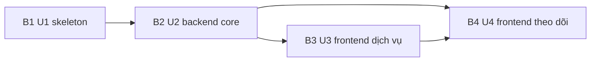

# Kế hoạch Bolt — TPP Callback Simulator (MVP)

> Bolt là một lượt xây dựng trọn một phần việc (một hoặc vài Unit), kết thúc bằng thứ chạy được. Unit là lát cắt xây dựng đã chia ở bước Units Generation (U1 đến U4). Walking skeleton là lát cắt nhỏ nhất chạy được từ đầu đến cuối, dùng để chứng minh các phần ghép với nhau. Tài liệu này đứng một mình: người đọc không cần đọc các tài liệu khác của bước này.
>
> Nguồn của kế hoạch: `requirements.md`, `stories.md`, `mockups.md`, `components.md`, `unit-of-work.md`, `unit-of-work-dependency.md`, `unit-of-work-story-map.md`, `contract-summary.md`, `team-practices.md` và các câu trả lời trong `delivery-planning-questions.md` (Q1 đến Q6 chọn A, 7 giả định chấp nhận).

## Thứ tự Bolt

Mỗi Bolt đúng một Unit. Thực thi tuần tự (một người, do aidlc-developer-agent thực hiện). Thứ tự này khớp thứ tự topo của đồ thị phụ thuộc (U1, rồi U2, rồi U3, rồi U4) và ba phần giao hàng của brief mục 9. Không có chỗ nào lệch khỏi thứ tự topo, nên không có điểm cần biện minh.

| Bolt | Unit | Kho git | Kiểu | Phụ thuộc | Walking skeleton |
|---|---|---|---|---|---|
| B1 | U1 `u1-backend-skeleton` | `tpp-simulator-app/` | `service` | — | Có |
| B2 | U2 `u2-backend-core` | `tpp-simulator-app/` | `service` | B1 | Không |
| B3 | U3 `u3-frontend-services` | `tpp-simulator-portal/` | `ui` | B2 | Không |
| B4 | U4 `u4-frontend-monitoring` | `tpp-simulator-portal/` | `ui` | B2, B3 | Không |

## B1 — U1 `u1-backend-skeleton` (walking skeleton)

- **Gồm.** Dự án Maven/Spring Boot trong `tpp-simulator-app/`, `compose.yaml` chạy PostgreSQL, lược đồ cơ sở dữ liệu (Service, ServiceConfigVersion, Callback, Transaction), README tối thiểu, API tạo dịch vụ tối giản, `POST /callbacks/{serviceCode}` đường vui, mapping `$.a.b.c`, timestamp ISO 8601, ghi nguyên tử Callback và Transaction, API đọc tối giản (danh sách giao dịch và chi tiết một giao dịch).
- **Chứng minh điều gì (kiến trúc).** Đường đi đầu-cuối: tạo dịch vụ, nhận callback, ánh xạ, lưu PostgreSQL, tra cứu qua API; khung dự án, lược đồ và công cụ build (Spotless, JaCoCo, Testcontainers) chạy được.
- **Definition of Done.**
  - Lệnh cURL thật với backend và PostgreSQL từ `compose.yaml` đạt tập con tiêu chí của U1 (AC1.1.1 đến AC1.1.4, AC1.6.1 đến AC1.6.5, AC1.10.1 đến AC1.10.5, AC1.14.1).
  - `mvn -B verify` xanh, kể cả kiểm thử tích hợp dùng Testcontainers.
  - Hợp đồng C1, C2 (tạo và đọc), C4 (đọc tối giản) và C6 được triển khai đúng `contract-summary.md`, sau khi xử lý hai điểm Major R-01 và R-02 của review Contract Design.
- **Giả thuyết cần kiểm chứng (confidence hypothesis).** Khung dự án, lược đồ và đường đi chính chạy đầu-cuối với PostgreSQL thật; ghi nguyên tử Callback và Transaction trong một giao dịch cơ sở dữ liệu hoạt động.
- **Demo mong đợi.** Chạy `docker compose up`, tạo dịch vụ `THU_HO` bằng cURL, gửi một callback, rồi tra cứu giao dịch bằng cURL và thấy `callbackCount` bằng 1.
- **Kiểm chứng thật.** Lệnh cURL đầu-cuối ở trên; lệnh chính xác do Construction chốt với bạn. Review của stage thiết kế đầu tiên không được coi là skeleton đã giao.
- **Chủ sở hữu.** aidlc-developer-agent.

## B2 — U2 `u2-backend-core`

- **Gồm.** Phần còn lại của bốn thành phần backend: kiểm tra cấu hình đầy đủ, sửa, bật/tắt, xóa mềm, phiên bản cấu hình, khóa API, toàn bộ thứ tự kiểm tra (404, 503, 401, 400, 413), ghi request bị từ chối, che header đầy đủ, 500 khi lỗi ghi, đồng thời, bộ lọc, phân trang, chi tiết, chỉ mục, API thử mapping, `docs/samples/` và script tạo ba dịch vụ mẫu, công cụ nạp dữ liệu thử để đo NFR1 với 100.000 callback.
- **Definition of Done.** Story US1.2 đến US1.5, US1.7 đến US1.9, US1.11 đến US1.14 và US2.11 đạt; kiểm thử tích hợp cho mapping, timestamp, xác thực, lịch sử, đồng thời và API xanh; JaCoCo từ 80%; đo được NFR1 (dưới 1 giây p95 với 100.000 callback) và NFR2 (50 callback cùng giao dịch, không mất bản ghi); không lộ khóa API trong log, header lịch sử hay response (NFR3).
- **Giả thuyết cần kiểm chứng.** Cách bảo đảm đồng thời và chỉ mục đã chọn đạt NFR1 và NFR2 trên máy local.
- **Demo mong đợi.** Chạy script tạo ba dịch vụ mẫu, gửi các payload mẫu bằng cURL, gửi 50 callback đồng thời cùng một mã giao dịch và thấy tổng đúng, rồi chạy công cụ nạp 100.000 callback và đo thời gian danh sách.
- **Chủ sở hữu.** aidlc-developer-agent.

## B3 — U3 `u3-frontend-services`

- **Gồm.** Dự án Vite/React/TypeScript trong `tpp-simulator-portal/`, khung ứng dụng (AppShell), các màn hình S1, S1a, S2, S3 (danh sách dịch vụ, cấu hình, thử mapping, gửi callback thử), Vite proxy `/api` và `/callbacks`, kiểm thử giao diện cho biểu mẫu cấu hình.
- **Definition of Done.** US2.1 đến US2.10 đạt khi chạy với backend thật; `npm run lint`, `format:check`, `test`, `build` xanh; truy cập mức cơ bản (NFR4) cho khung và biểu mẫu.
- **Giả thuyết cần kiểm chứng.** Người dùng cấu hình dịch vụ, thử mapping và gửi thử từ trình duyệt mà không cần dùng cURL.
- **Demo mong đợi.** Tạo dịch vụ mới bằng giao diện, thử mapping với JSON mẫu, gửi thử callback và thấy status, body, thời gian phản hồi.
- **Ghi chú.** Giao diện theo thiết kế Stitch với API giả có thể đã dựng sớm; khi đó Bolt này nối sang API thật bằng cách đổi `VITE_USE_MOCK`, thay vì dựng lại.
- **Chủ sở hữu.** aidlc-developer-agent.

## B4 — U4 `u4-frontend-monitoring`

- **Gồm.** Các màn hình S4, S5a, S5b (hai tab Giao dịch và Tất cả callback, ngăn chi tiết), tự cập nhật mỗi 5 giây, kiểm thử bộ lọc và tự cập nhật.
- **Definition of Done.** US3.1 đến US3.9 đạt khi chạy với backend thật; tự cập nhật giữ bộ lọc, trang và ngăn chi tiết đang mở; kiểm thử giao diện xanh; mười tiêu chí nghiệm thu ở brief mục 8 đều đạt (README chạy được từ bản checkout sạch).
- **Giả thuyết cần kiểm chứng.** Toàn bộ MVP đạt tiêu chí nghiệm thu.
- **Demo mong đợi.** Gửi callback bằng cURL và bằng trang gửi thử, thấy dòng mới ở màn hình theo dõi trong 5 giây, mở ngăn chi tiết để xem lịch sử.
- **Chủ sở hữu.** aidlc-developer-agent.

## Cách Construction dùng kế hoạch này

- **Thứ tự theo từng Unit.** Mỗi Unit đi qua các stage thiết kế áp dụng và Code Generation, rồi một điểm kiểm chứng hoàn thành, trước khi sang Unit kế tiếp. Skeleton bật nên U1 hoàn tất trọn vẹn trước mọi Unit khác.
- **Tuần tự, một phiên.** Không chia đội; không chạy song song Bolt.
- **Lệnh kiểm chứng.** Một lệnh kiểm chứng cho cả intent do bạn duyệt ở cuối stage này; lệnh phải kiểm các kết quả chạy được của các Unit đã xong.
- **Bolt không điều khiển engine.** Engine đọc đồ thị phụ thuộc của `unit-of-work-dependency.md`; tài liệu này ghi lý do kinh tế và Definition of Done.
