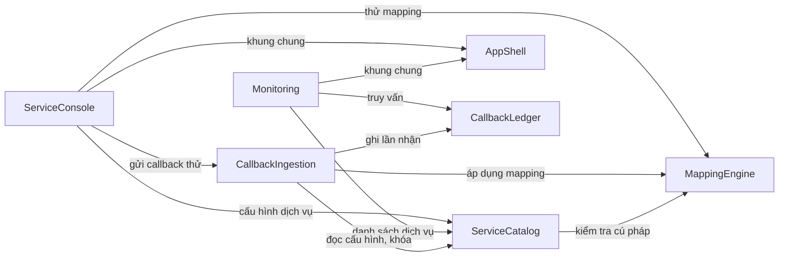

# Danh mục thành phần — TPP Callback Simulator (MVP)

> Nguồn: `requirements.md` (FR1–FR12, NFR1–NFR7), `stories.md` (44 mã story), `team-practices.md`, các quyết định của bạn trong `domain-design-questions.md` (Q1–Q3 chọn A và 12 giả định đã chấp nhận). Bước này chỉ chọn các khối xây dựng và chủ sở hữu thực thể. Cách gom thành đơn vị triển khai thuộc Units Generation; kiểu dữ liệu, ràng buộc và quan hệ chi tiết thuộc Functional Design; nội dung API thuộc Contract Design.
>
> Thành phần là phần mã bạn viết. PostgreSQL, trình duyệt và hệ thống ngân hàng là phụ thuộc ngoài, không phải thành phần.

## Phần A — Danh mục máy đọc được

```yaml
components:
  - name: ServiceCatalog
    summary: "Quản lý cấu hình dịch vụ callback và các phiên bản cấu hình bất biến của chúng."
    behaviour: >
      Mã dịch vụ dài 1 đến 50 ký tự gồm chữ, số, dấu gạch ngang và gạch dưới; trùng không phân biệt hoa thường,
      kể cả với dịch vụ đã xóa, và không đổi được sau khi tạo. Tên bắt buộc. Xác thực là NONE hoặc API_KEY;
      với API_KEY bắt buộc có tên header và khóa. Khóa chỉ ghi vào, không bao giờ trả ra qua API quản lý;
      khi sửa, khóa để trống nghĩa là giữ khóa cũ. Đường dẫn mapping, định dạng thời gian, mẫu chuỗi và múi giờ
      được kiểm tra khi lưu bằng MappingEngine. Response cố định có HTTP status từ 200 đến 599 và body là JSON hợp lệ.
      Mỗi lần lưu mà phần cấu hình dùng để xử lý callback thay đổi (đường dẫn mapping, định dạng thời gian, múi giờ,
      response) thì tạo một ServiceConfigVersion mới, số phiên bản tăng dần theo từng dịch vụ; sửa chỉ riêng tên,
      mô tả, xác thực hay bật/tắt thì không tạo phiên bản mới. Bật/tắt và xóa mềm chỉ đổi trạng thái. Dịch vụ đã xóa
      biến khỏi danh sách cấu hình nhưng vẫn tra cứu được theo mã để phục vụ lịch sử và bộ lọc. Cung cấp cho
      CallbackIngestion cấu hình hiện hành của một mã dịch vụ (trạng thái, xác thực, khóa, phiên bản mới nhất).
    responsibilities:
      - "Tạo, sửa, bật/tắt, xóa mềm và liệt kê dịch vụ"
      - "Kiểm tra tính hợp lệ của cấu hình khi lưu"
      - "Giữ khóa API và chỉ đưa cho CallbackIngestion để so khớp"
      - "Tạo và lưu các ServiceConfigVersion bất biến"
      - "Cung cấp danh sách dịch vụ kể cả đã xóa cho bộ lọc theo dõi"
    depends_on:
      - component: MappingEngine
        interaction: "Kiểm tra cú pháp đường dẫn, mẫu chuỗi ngày giờ khi lưu cấu hình"
        style: sync
    dependents:
      - component: CallbackIngestion
        interaction: "Đọc cấu hình hiện hành và khóa của dịch vụ khi nhận callback"
      - component: ServiceConsole
        interaction: "Màn hình danh sách, cấu hình, bật/tắt, xóa dịch vụ"
      - component: Monitoring
        interaction: "Lấy danh sách dịch vụ kể cả đã xóa cho bộ lọc"
    external_dependencies:
      - name: PostgreSQL
        kind: database
        purpose: "Lưu dịch vụ và các phiên bản cấu hình"
    entities:
      - name: Service
        identifier: serviceCode
        attributes: [serviceCode, name, description, enabled, deleted, authType, apiKeyHeaderName, apiKeySecret, currentVersionNumber, createdAt, updatedAt]
      - name: ServiceConfigVersion
        identifier: versionId
        attributes: [versionId, serviceCode, versionNumber, transactionIdPath, statusPath, timestampPath, timestampFormat, timestampPattern, defaultTimeZone, responseHttpStatus, responseBody, createdAt]
        references:
          - entity: Service
            owned_by: ServiceCatalog
            relationship: "mỗi ServiceConfigVersion thuộc về đúng một Service"

  - name: MappingEngine
    summary: "Áp dụng cấu hình ánh xạ lên payload JSON và chuẩn hóa timestamp; dùng chung cho nhận callback, thử mapping và kiểm tra cấu hình."
    behaviour: >
      Đường dẫn chỉ có dạng dấu đô la, các tên khóa nối bằng dấu chấm, đi qua các object lồng nhau; không hỗ trợ
      wildcard, filter hay chỉ số mảng. Giá trị chuỗi, số, boolean được lấy nguyên văn thành chuỗi. Với
      transactionId và status, không tìm thấy, null, chuỗi rỗng, object hoặc mảng đều là lỗi riêng của trường đó;
      payload gốc không phải object thì cả ba trường đều lỗi. Timestamp là trường tùy chọn: thiếu thì chỉ cảnh báo,
      có mà không đọc được theo định dạng đã cấu hình là lỗi của trường timestamp. Hỗ trợ ISO 8601, Unix giây, Unix mili giây
      và mẫu chuỗi theo cú pháp DateTimeFormatter của Java kèm múi giờ mặc định cho chuỗi không có múi giờ; kết quả chuẩn hóa về UTC.
      Không giữ trạng thái và không ghi dữ liệu. Cung cấp hai việc: áp dụng cấu hình đã lưu cho một payload (lúc nhận callback)
      và thử mapping với cấu hình đang nhập trên form (chưa lưu), cùng một bộ quy tắc, để kết quả thử đúng bằng kết quả thật.
    responsibilities:
      - "Kiểm tra cú pháp đường dẫn và mẫu chuỗi ngày giờ"
      - "Trích transactionId, status, timestamp từ payload và báo lỗi từng trường"
      - "Chuẩn hóa timestamp về UTC"
      - "Cung cấp thử mapping không lưu dữ liệu"
    depends_on: []
    dependents:
      - component: ServiceCatalog
        interaction: "Kiểm tra cú pháp cấu hình khi lưu"
      - component: CallbackIngestion
        interaction: "Áp dụng cấu hình đã lưu lên payload của từng callback"
      - component: ServiceConsole
        interaction: "Thử mapping với JSON mẫu và cấu hình đang nhập"
    external_dependencies: []
    entities: []

  - name: CallbackIngestion
    summary: "Quy trình nhận callback tại POST /callbacks/{serviceCode}: kiểm tra theo thứ tự, ánh xạ, che header, ghi lại và trả response đã cấu hình."
    behaviour: >
      Thứ tự kiểm tra: dịch vụ không tồn tại thì 404 và không ghi gì; dịch vụ đã xóa thì 404; dịch vụ tắt thì 503;
      API key sai hoặc thiếu thì 401 (tên header không phân biệt hoa thường, giá trị so khớp chính xác); Content-Type
      không phải JSON hoặc JSON hỏng thì 400; sau đó mapping, ghi, trả response đã cấu hình. Body lớn hơn 1 MB thì 413
      và không ghi. Mọi request tới dịch vụ có thật bị từ chối đều được ghi như một lần nhận kèm mã HTTP đã trả và lý do,
      body không phải JSON ghi dạng văn bản gốc. Mapping lỗi vẫn trả response đã cấu hình. Lỗi ghi một callback được chấp nhận
      thì trả 500 và không trả response đã cấu hình. Thời điểm nhận do server gán khi bắt đầu nhận request. Trước khi giao cho
      CallbackLedger, che các header Authorization, Proxy-Authorization, Cookie và header API key của dịch vụ thành ba dấu sao.
      Không ghi giá trị khóa vào log.
    responsibilities:
      - "Điều phối thứ tự kiểm tra và chọn mã HTTP trả về"
      - "Đọc cấu hình hiện hành và so khớp API key"
      - "Gọi MappingEngine để ánh xạ payload"
      - "Che header nhạy cảm trước khi lưu"
      - "Yêu cầu CallbackLedger ghi mọi kết quả cần ghi và trả response đã cấu hình"
    depends_on:
      - component: ServiceCatalog
        interaction: "Đọc cấu hình hiện hành và khóa của dịch vụ"
        style: sync
      - component: MappingEngine
        interaction: "Áp dụng cấu hình ánh xạ lên payload"
        style: sync
      - component: CallbackLedger
        interaction: "Ghi lần nhận và cập nhật giao dịch"
        style: sync
    dependents:
      - component: ServiceConsole
        interaction: "Trang gửi thử gọi chính endpoint callback thật"
    external_dependencies: []
    entities: []

  - name: CallbackLedger
    summary: "Sổ ghi mọi lần nhận (Callback) và giao dịch (Transaction): ghi nguyên tử và truy vấn có lọc, phân trang."
    behaviour: >
      Mỗi lần nhận được ghi thành một Callback riêng, không bao giờ bị ghi đè hay xóa; không khử trùng. Callback của lần nhận
      được chấp nhận và có transactionId hợp lệ được gom vào Transaction theo cặp (serviceCode, transactionId); việc ghi Callback
      và cập nhật Transaction nằm trong cùng một giao dịch cơ sở dữ liệu. Transaction giữ status, timestamp nghiệp vụ, thời điểm nhận
      và mã bản ghi của lần nhận gần nhất, cùng tổng số callback; gần nhất xét theo thời điểm nhận rồi tới mã bản ghi lớn nhất,
      không xét timestamp nghiệp vụ. Nếu lần nhận gần nhất thiếu status thì giao dịch hiển thị thiếu giá trị và lỗi mapping, không giữ status cũ.
      Callback thiếu hoặc lỗi transactionId, và Callback bị từ chối, không thuộc giao dịch nào. Khi nhiều callback cùng giao dịch
      đến đồng thời, không mất callback nào và tổng số đúng. Truy vấn danh sách giao dịch và danh sách callback có lọc (dịch vụ, transactionId
      chứa chuỗi, status chứa chuỗi, khoảng thời gian nhận tính cả hai đầu, kết quả xử lý và lý do bị từ chối), sắp mới nhất trước, hòa nhau theo mã bản ghi,
      phân trang 20, 50 hoặc 100 dòng; truy vấn chi tiết giao dịch với lịch sử callback theo thứ tự nhận và chi tiết một lần nhận.
      Payload lưu dạng JSONB, body không phải JSON lưu nguyên văn. Danh sách có lọc và phân trang phải dưới 1 giây (p95) với 100.000 callback.
    responsibilities:
      - "Ghi Callback và cập nhật Transaction nguyên tử"
      - "Bảo đảm đúng khi ghi đồng thời cùng một giao dịch"
      - "Truy vấn có lọc, phân trang và chi tiết"
      - "Giữ toàn bộ lịch sử, kể cả của dịch vụ đã xóa"
    depends_on: []
    dependents:
      - component: CallbackIngestion
        interaction: "Ghi lần nhận và cập nhật giao dịch"
      - component: Monitoring
        interaction: "Truy vấn giao dịch, callback và chi tiết"
    external_dependencies:
      - name: PostgreSQL
        kind: database
        purpose: "Lưu Callback và Transaction (JSONB cho payload) và phục vụ truy vấn có chỉ mục"
    entities:
      - name: Callback
        identifier: recordId
        attributes: [recordId, serviceCode, configVersionId, receivedAt, outcome, rejectionReason, httpStatusReturned, requestHeadersMasked, payloadJson, payloadRawText, transactionId, status, businessTimestampUtc, mappingFieldResults, responseStatusReturned, responseBodyReturned]
        references:
          - entity: ServiceConfigVersion
            owned_by: ServiceCatalog
            relationship: "mỗi Callback tham chiếu đúng một phiên bản cấu hình đã dùng để xử lý nó"
          - entity: Service
            owned_by: ServiceCatalog
            relationship: "mỗi Callback thuộc về một dịch vụ, kể cả dịch vụ đã xóa"
      - name: Transaction
        identifier: "(serviceCode, transactionId)"
        attributes: [serviceCode, transactionId, latestStatus, latestBusinessTimestampUtc, latestReceivedAt, latestCallbackId, latestHasMappingError, callbackCount]
        references:
          - entity: Callback
            owned_by: CallbackLedger
            relationship: "mỗi Transaction trỏ tới Callback nhận gần nhất và có nhiều Callback"
          - entity: Service
            owned_by: ServiceCatalog
            relationship: "mỗi Transaction thuộc về một dịch vụ"

  - name: AppShell
    summary: "Khung ứng dụng frontend và các thành phần giao diện dùng chung."
    behaviour: >
      Khung trang với thanh bên (thu thành thanh hẹp ở 1024 đến 1279 pixel), header có nhãn UAT và múi giờ, banner khi cửa sổ hẹp hơn 1024 pixel,
      liên kết bỏ qua tới nội dung, thông báo ngắn, và điều hướng giữa hai khu vực. Cung cấp các thành phần dùng lại ở nhiều nơi:
      khung xem JSON chỉ đọc, bảng dữ liệu, thanh bộ lọc, công tắc, hộp thoại xác nhận, ngăn trượt, nút sao chép. Cung cấp lớp gọi API
      chung (xử lý lỗi, mã HTTP) và định dạng thời gian theo Asia/Ho_Chi_Minh kèm nhãn GMT+7. Bố cục và phong cách theo Stitch,
      mức truy cập cơ bản theo accessibility-checklist.md. Không có logic nghiệp vụ.
    responsibilities:
      - "Khung ứng dụng, điều hướng và thông báo"
      - "Thành phần giao diện dùng lại"
      - "Lớp gọi API và định dạng thời gian dùng chung"
    depends_on: []
    dependents:
      - component: ServiceConsole
        interaction: "Dùng khung và các thành phần giao diện chung"
      - component: Monitoring
        interaction: "Dùng khung và các thành phần giao diện chung"
    external_dependencies: []
    entities: []

  - name: ServiceConsole
    summary: "Giao diện quản lý dịch vụ: danh sách, cấu hình, thử mapping và gửi callback thử (S1, S2, S3)."
    behaviour: >
      Danh sách dịch vụ có tìm kiếm, lọc theo trạng thái, sao chép URL, bật/tắt và xóa có xác nhận; biểu mẫu cấu hình với kiểm tra khi lưu,
      khóa API che và giữ khóa cũ khi để trống, cảnh báo khi rời trang có thay đổi chưa lưu; thử mapping dùng cấu hình đang nhập; trang
      gửi thử gọi chính endpoint callback thật, đo thời gian phản hồi ở trình duyệt và không bao giờ nhận khóa thật từ backend.
      Các nút mẫu dựng JSON từ đường dẫn mapping đang nhập.
    responsibilities:
      - "Màn hình S1, S1a, S2, S3"
      - "Hiển thị lỗi kiểm tra và trạng thái tải, trống, lỗi"
      - "Dựng payload mẫu và đo thời gian phản hồi khi gửi thử"
    depends_on:
      - component: AppShell
        interaction: "Dùng khung và thành phần giao diện chung"
        style: sync
      - component: ServiceCatalog
        interaction: "Đọc và ghi cấu hình dịch vụ"
        style: sync
      - component: MappingEngine
        interaction: "Thử mapping với cấu hình đang nhập"
        style: sync
      - component: CallbackIngestion
        interaction: "Gửi callback thử qua endpoint thật"
        style: sync
    dependents: []
    external_dependencies:
      - name: Trình duyệt máy tính
        kind: other
        purpose: "Nền chạy giao diện; hỗ trợ từ 1024 pixel, tối ưu từ 1280 pixel"
    entities: []

  - name: Monitoring
    summary: "Giao diện theo dõi: danh sách giao dịch, tất cả callback và ngăn chi tiết (S4, S5)."
    behaviour: >
      Hai tab Giao dịch và Tất cả callback, mỗi tab giữ bộ lọc và trang riêng; bộ lọc chỉ áp dụng khi bấm Áp dụng; phân trang phía server;
      tự cập nhật mỗi 5 giây có thể tắt, bỏ qua nhịp khi lần tải trước chưa xong, giữ bộ lọc, trang và ngăn chi tiết đang mở, giữ dữ liệu cũ
      kèm thông báo khi tải lỗi; ngăn chi tiết giao dịch với lịch sử theo thứ tự nhận và chi tiết một lần nhận; ba thông báo rỗng
      (chưa có dữ liệu, không khớp bộ lọc, lỗi tải) khác nhau.
    responsibilities:
      - "Màn hình S4, S5a, S5b"
      - "Bộ đếm tự cập nhật và xử lý lỗi khi cập nhật"
      - "Giữ trạng thái bộ lọc và trang theo từng tab"
    depends_on:
      - component: AppShell
        interaction: "Dùng khung và thành phần giao diện chung"
        style: sync
      - component: CallbackLedger
        interaction: "Truy vấn giao dịch, callback và chi tiết"
        style: sync
      - component: ServiceCatalog
        interaction: "Lấy danh sách dịch vụ kể cả đã xóa cho bộ lọc"
        style: sync
    dependents: []
    external_dependencies:
      - name: Trình duyệt máy tính
        kind: other
        purpose: "Nền chạy giao diện; hỗ trợ từ 1024 pixel, tối ưu từ 1280 pixel"
    entities: []
```

## Phần B — Cách nhìn cho người đọc

### Sơ đồ thành phần



Hệ thống ngân hàng bên ngoài gọi `POST /callbacks/{serviceCode}` vào CallbackIngestion; không có mũi tên từ thành phần nào của ứng dụng ra hệ thống ngân hàng (brief mục 7).

### Tóm tắt thành phần

| Component | Mục đích | Phụ thuộc | Được gọi bởi | Thực thể sở hữu |
|---|---|---|---|---|
| ServiceCatalog | Cấu hình dịch vụ và phiên bản cấu hình | MappingEngine | CallbackIngestion, ServiceConsole, Monitoring | Service, ServiceConfigVersion |
| MappingEngine | Ánh xạ payload, chuẩn hóa timestamp, thử mapping | — | ServiceCatalog, CallbackIngestion, ServiceConsole | — |
| CallbackIngestion | Quy trình nhận callback | ServiceCatalog, MappingEngine, CallbackLedger | ServiceConsole | — |
| CallbackLedger | Ghi và truy vấn lần nhận, giao dịch | — | CallbackIngestion, Monitoring | Callback, Transaction |
| AppShell | Khung và thành phần giao diện chung | — | ServiceConsole, Monitoring | — |
| ServiceConsole | Màn hình S1, S2, S3 | AppShell, ServiceCatalog, MappingEngine, CallbackIngestion | — | — |
| Monitoring | Màn hình S4, S5 | AppShell, CallbackLedger, ServiceCatalog | — | — |

### Quyền sở hữu thực thể

| Entity | Component sở hữu | Định danh | Thuộc tính | Tham chiếu |
|---|---|---|---|---|
| Service | ServiceCatalog | serviceCode | serviceCode, name, description, enabled, deleted, authType, apiKeyHeaderName, apiKeySecret, currentVersionNumber, createdAt, updatedAt | — |
| ServiceConfigVersion | ServiceCatalog | versionId | versionId, serviceCode, versionNumber, transactionIdPath, statusPath, timestampPath, timestampFormat, timestampPattern, defaultTimeZone, responseHttpStatus, responseBody, createdAt | Service |
| Callback | CallbackLedger | recordId | recordId, serviceCode, configVersionId, receivedAt, outcome, rejectionReason, httpStatusReturned, requestHeadersMasked, payloadJson, payloadRawText, transactionId, status, businessTimestampUtc, mappingFieldResults, responseStatusReturned, responseBodyReturned | ServiceConfigVersion, Service |
| Transaction | CallbackLedger | (serviceCode, transactionId) | serviceCode, transactionId, latestStatus, latestBusinessTimestampUtc, latestReceivedAt, latestCallbackId, latestHasMappingError, callbackCount | Callback, Service |

Ghi chú về thực thể: mức này chỉ ghi chủ sở hữu, định danh, tên thuộc tính và tham chiếu chéo. Kiểu dữ liệu, ràng buộc và quan hệ chi tiết thuộc Functional Design.

### Phụ thuộc ngoài

| Component | Dependency | Loại | Mục đích |
|---|---|---|---|
| ServiceCatalog | PostgreSQL | database | Lưu dịch vụ và phiên bản cấu hình |
| CallbackLedger | PostgreSQL | database | Lưu Callback, Transaction (JSONB) và phục vụ truy vấn có chỉ mục |
| ServiceConsole | Trình duyệt máy tính | other | Nền chạy giao diện |
| Monitoring | Trình duyệt máy tính | other | Nền chạy giao diện |

### Lý do tách

| Component | Lý do là một khối riêng |
|---|---|
| ServiceCatalog | Vòng đời riêng (cấu hình do con người sửa, ít thay đổi); sở hữu dữ liệu cấu hình và khóa; tốc độ thay đổi chậm hơn nhiều so với dữ liệu callback. |
| MappingEngine | Một mối quan tâm riêng, không trạng thái; được ba nơi dùng (kiểm tra cấu hình, nhận callback, thử mapping) nên đặt ở một chỗ để kết quả thử luôn đúng bằng kết quả thật. |
| CallbackIngestion | Quy trình có thứ tự kiểm tra và mã HTTP là hợp đồng với hệ thống bên ngoài, đổi theo yêu cầu của ngân hàng chứ không theo dữ liệu hay giao diện. |
| CallbackLedger | Sở hữu dữ liệu tăng mãi (callback, giao dịch) và yêu cầu về đồng thời, chỉ mục, hiệu năng; ghi và đọc chia sẻ cùng dữ liệu nên đặt cùng một chủ. |
| AppShell | Phần dùng chung không có nghiệp vụ; tách để hai khu vực dùng cùng khung và cùng thành phần, nhất quán về truy cập. |
| ServiceConsole | Nhóm màn hình có cùng người dùng chính (lập trình viên) và cùng ba phụ thuộc quản lý; thay đổi cùng nhịp. |
| Monitoring | Nhóm màn hình có cùng người dùng chính (người kiểm thử) và cùng một nguồn dữ liệu; có bộ đếm tự cập nhật riêng. |

### Các phương án ranh giới đã cân nhắc

**Backend (Q2).**

- Phương án A — Bốn thành phần (đã chọn): mỗi khối có một mối quan tâm và một chủ dữ liệu rõ. Dễ giữ ghi nguyên tử callback và giao dịch trong một chỗ. Thay đổi sau này dễ: tách phía đọc nếu cần.
- Phương án B — Năm thành phần, thêm MonitoringQuery chỉ truy vấn: tách đọc khỏi ghi nhưng cùng dùng chung hai bảng, nên phải phân định thêm ai sở hữu bảng; thêm công mà MVP chưa cần. Bị loại.
- Phương án C — Ba thành phần, gộp CallbackIngestion và CallbackLedger: ít ranh giới nhưng quy trình nhận hợp đồng HTTP và lưu cùng truy vấn dính vào nhau; khó kiểm thử riêng. Bị loại.
- Khuyến nghị: A, vì giữ mỗi khối ở một nhịp thay đổi.

**Frontend (Q3).**

- Phương án A — Ba thành phần (đã chọn): khung và thành phần dùng chung tách riêng, hai khu vực tách theo người dùng chính.
- Phương án B — Một thành phần frontend: bỏ ranh giới, thành phần dùng chung lẫn với màn hình. Bị loại.
- Phương án C — Mỗi màn hình một thành phần cộng thành phần dùng chung: nhiều ranh giới nhưng các màn hình S1–S3 và S4–S5 luôn đổi cùng nhau. Bị loại.

## Nguồn

- `aidlc/spaces/default/intents/261018-tpp-callback-simulator/inception/requirements-analysis/requirements.md`
- `aidlc/spaces/default/intents/261018-tpp-callback-simulator/inception/user-stories/stories.md`
- `aidlc/spaces/default/intents/261018-tpp-callback-simulator/inception/practices-discovery/team-practices.md`
- `aidlc/spaces/default/intents/261018-tpp-callback-simulator/inception/refined-mockups/mockups.md` (màn hình S1–S5)
- `aidlc/spaces/default/intents/261018-tpp-callback-simulator/inception/domain-design/domain-design-questions.md` (Q1–Q3 và 12 giả định)

## Assumptions & Open Questions

Các điểm chưa quyết ở bước này và bước dự kiến chốt (chi tiết trong `decisions.md`):

- Vị trí kiểm tra giới hạn 1 MB (413) so với các kiểm tra khác, và giới hạn là 1.000.000 hay 1.048.576 byte: Contract Design.
- Khi không ghi được một request bị từ chối, trả mã từ chối gốc hay 500: Functional Design.
- Cách lưu khóa API (băm hay mã hóa): NFR Requirements.
- Cách bảo đảm đúng khi ghi đồng thời (khóa dòng hay upsert có điều kiện) và chỉ mục cho 100.000 callback: NFR Design.
- Địa chỉ gốc hiển thị trong URL callback (cấu hình frontend): Code Generation.
- Nội dung body response cho các mã lỗi 401, 400, 503, 404, 413, 500: Contract Design.
