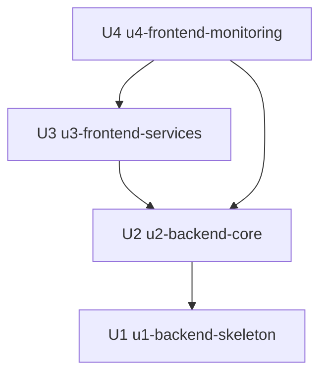

# Phụ thuộc giữa các Unit — TPP Callback Simulator (MVP)

> Chỉ mô tả cấu trúc (topology): Unit nào có thể phụ thuộc Unit nào. Tài liệu này **không** đề xuất thứ tự xây dựng hay đường găng; chọn thứ tự giao hàng theo giá trị hay rủi ro là việc của Delivery Planning, dùng đồ thị này làm đầu vào. Thứ tự ba phần của brief mục 9 (backend, frontend cấu hình, frontend theo dõi) là ràng buộc bạn đã chốt và được phản ánh trong các cạnh dưới đây.

## Đồ thị phụ thuộc

Cạnh "A phụ thuộc B" nghĩa là A cần B đã tồn tại và kiểm chứng được.

| Unit | Phụ thuộc vào | Lý do |
|---|---|---|
| U1 `u1-backend-skeleton` | — | Là lát cắt đầu tiên, chạy được độc lập với PostgreSQL từ `compose.yaml` |
| U2 `u2-backend-core` | U1 | Mở rộng cùng ứng dụng, mô-đun mã và lược đồ cơ sở dữ liệu của U1 |
| U3 `u3-frontend-services` | U2 | Cạnh theo ràng buộc thứ tự brief mục 9 (làm xong và kiểm chứng backend rồi mới sang frontend), không phải phụ thuộc mã: về kỹ thuật U3 chỉ cần hợp đồng API của U2 |
| U4 `u4-frontend-monitoring` | U2, U3 | Cạnh tới U2 theo ràng buộc brief mục 9 như U3; cạnh tới U3 là phụ thuộc mã thật vì U4 dùng AppShell của U3 trong cùng ứng dụng frontend |



Khối cạnh dạng máy đọc được (nguồn của việc sắp xếp ở các bước sau; đồ thị không có vòng, mỗi Unit được khai báo đúng một lần):

```yaml
units:
  - name: u1-backend-skeleton
    kind: service
    depends_on: []
  - name: u2-backend-core
    kind: service
    depends_on: [u1-backend-skeleton]
  - name: u3-frontend-services
    kind: ui
    depends_on: [u2-backend-core]
  - name: u4-frontend-monitoring
    kind: ui
    depends_on: [u2-backend-core, u3-frontend-services]
```

## Điểm tích hợp giữa các Unit

| Giữa | Cách tích hợp | Dữ liệu dùng chung | Ghi chú |
|---|---|---|---|
| U1 → U2 | Cùng một ứng dụng Spring Boot, cùng mô-đun mã | Lược đồ cơ sở dữ liệu của Service, ServiceConfigVersion, Callback, Transaction | U2 mở rộng, không viết lại; thay đổi lược đồ đi qua các bản chuyển lược đồ đánh số |
| U2 → U3 | HTTP REST đồng bộ | Cấu hình dịch vụ, kết quả thử mapping, callback gửi thử | Vite proxy `/api` và `/callbacks` khi chạy dev; không cấu hình CORS; hợp đồng do Contract Design chốt |
| U2 → U4 | HTTP REST đồng bộ | Giao dịch, callback, chi tiết; danh sách dịch vụ kể cả đã xóa | Phân trang và lọc phía server; hợp đồng do Contract Design chốt |
| U3 → U4 | Import trong cùng ứng dụng frontend | Thành phần AppShell (khung, bảng, bộ lọc, khung xem JSON, hộp thoại, ngăn trượt, nút sao chép, lớp gọi API, định dạng thời gian) | Chỉ những thứ ít nhất hai khu vực cùng dùng được đưa vào AppShell (ADR-003) |

Không có sự kiện, hàng đợi hay chia sẻ cơ sở dữ liệu giữa hai kho git: frontend chỉ nói chuyện với backend qua HTTP (ADR-008).

## Cơ hội song song

Với các cạnh hiện có, không cặp Unit nào độc lập với nhau: U2 phụ thuộc U1, U3 phụ thuộc U2, và U4 phụ thuộc cả U2 lẫn U3. Đây là mô tả cấu trúc của đồ thị, không phải lời khuyên về thứ tự làm việc.

Hai cạnh U3 → U2 và U4 → U2 xuất phát từ ràng buộc thứ tự giao hàng của brief mục 9, không phải từ phụ thuộc mã (xem cột "Lý do" ở trên). Nếu sau này có thêm người và hợp đồng API đã chốt ở Contract Design, hai cạnh này có thể được nới thành phụ thuộc vào hợp đồng thay vì vào mã hoàn chỉnh của U2; khi đó đồ thị và bảng này cần cập nhật cùng nhau. Hiện tại chỉ có một người làm tuần tự nên không tận dụng điều này.

## Lát cắt skeleton

U1 là Unit đầu tiên trong đồ thị và là lát cắt tích hợp: chạy được trước khi U2, U3, U4 tồn tại. Cụ thể U1 đi qua toàn bộ đường tạo dịch vụ, nhận `POST /callbacks/{serviceCode}`, ánh xạ, lưu PostgreSQL (Callback và Transaction nguyên tử), và tra cứu giao dịch qua một API đọc tối giản. Điều này đúng với thứ tự trong đồ thị (U1 không phụ thuộc Unit nào), nên không cần đánh dấu riêng ở `bolt-plan.md`.
